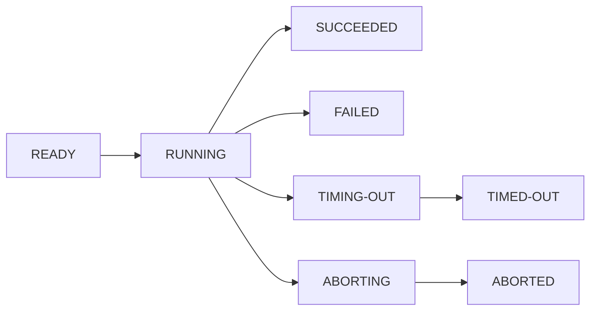

## Lifecycle

Each run and build starts with the initial status **READY** and goes through one or more transitional statuses to one of the terminal statuses.

While a run or build is still **READY**, it can also time out, or you can abort it.

| Status | Type | Description |
| --- | --- | --- |
| READY | initial | Started but not allocated to any worker yet |
| RUNNING | transitional | Executing on a worker machine |
| SUCCEEDED | terminal | Finished successfully |
| FAILED | terminal | Run failed |
| TIMING-OUT | transitional | Timing out now |
| TIMED-OUT | terminal | Timed out |
| ABORTING | transitional | Run is being aborted |
| ABORTED | terminal | Run aborted |
