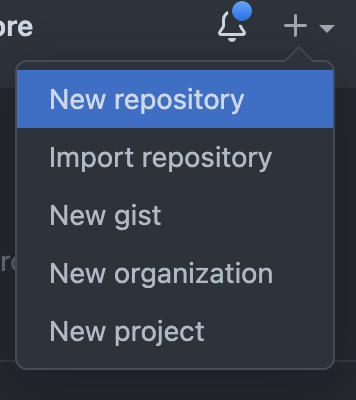
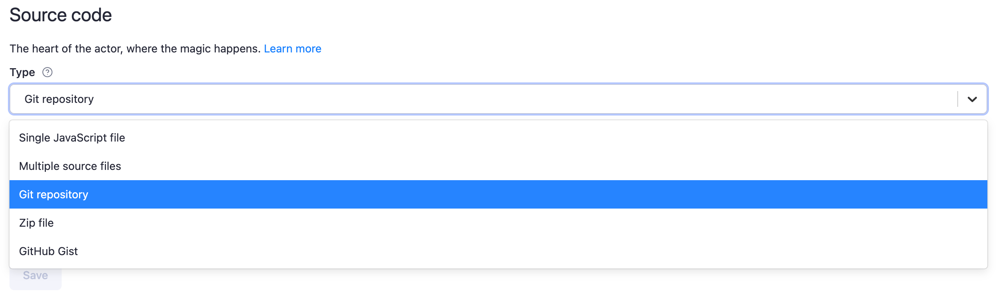
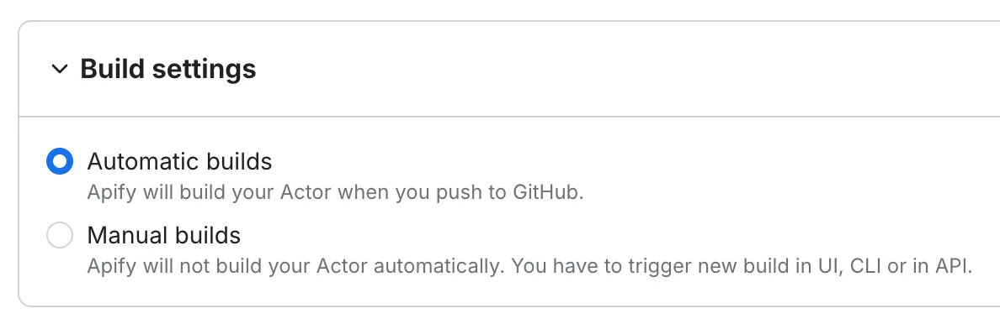

**Learn how to manage your Actor's source code more efficiently by integrating it with a GitHub repository. This is standard on the Apify platform.**

---

In this brief lesson, we'll discuss how to better manage an Actor's source code. Up 'til now, you've been developing your scripts locally, and then pushing the code directly to the Actor on the Apify platform; however, there is a much more optimal (and standard) way.

## Learning 🧠 {#learning}

Thus far, every time we've updated our code on the Apify platform, we've used the `apify push` CLI command; however, this can be problematic for a few reasons - mainly because, if someone else wants to make a change to/maintain your code, they don't have access to it, as it is on your local machine.

If you're not yet familiar with Git, please get familiar with it through the [Git documentation](https://git-scm.com/docs), then take a quick moment to read about [GitHub integration](/integrations/github) in the Apify docs.

Also, try to explore the **Multifile editor** in one of the Actors you developed in the previous lessons before moving forward.

## Knowledge check 📝 {#quiz}

1. Do you have to rebuild an Actor each time the source code is changed?
2. In Git, what is the difference between **pushing** changes and making a **pull request**?
3. Based on your knowledge and experience, is the `apify push` command worth using (in your opinion)?

[**Answers**](./solutions/managing_source.md)

## Our task {#our-task}

First, we must initialize a GitHub repository (you can use Gitlab if you like, but this lesson's examples will be using GitHub). Then, after pushing our main Amazon Actor's code to the repo, we must switch its source code to use the content of the GitHub repository instead.

## Integrating GitHub source code {#integrating-github}

First, let's create a repository. This can be done [in a number of ways](https://kbroman.org/github_tutorial/pages/init.html), but in this lesson, we'll do it by creating the remote repository on GitHub's website:



GitHub then suggests commands for pushing an existing repository, but we can't use them as they are. We cloned **academy-amazon-scraper** from the starter repository, so its `origin` remote already points to `apify-projects/academy-amazon-scraper`, and `git remote add origin …` would fail with `remote origin already exists`. Instead, we'll point `origin` to our new repository and push all of the files to it. Run the following in the **academy-amazon-scraper** directory, with your own repository URL:

```bash
git remote set-url origin https://github.com/YOUR_USERNAME/academy-amazon-scraper.git
git push -u origin main
```

After you've created your repo, in the Apify platform navigate to your **academy-amazon-scraper** Actor. In the **Source** tab, click the dropdown menu under **Source code** and select **Git repository**. By default, this is set to **Web IDE**, which is what we've been using so far.



Then, go ahead and paste the link to your repository into the **Git URL** text field and click **Save**.

The final step is to check your **Build settings**. Under the Git URL field, there're two options: **Automatic builds** and **Manual builds**. Select **Automatic builds**. It tells Apify to rebuild your Actor whenever you push to GitHub, with no extra configuration needed.



And you're done! 🎉

## Quick chat about code management {#code-management}

This was a bit of overhead, but the good news is that you don't ever have to configure this stuff again for this Actor. Now, every time the content of your **main**/**master** branch changes, the Actor on the Apify platform will rebuild based on the newest code.

Think of it as combining two steps into one. Normally, you'd have to do a `git push` from your terminal to get the newest code onto GitHub, then run `apify push` to push it to the platform.

It's also important to know that GitHub/Gitlab repository integration is standard practice. As projects grow and the number of contributors and maintainers increases, it only makes sense to have a GitHub repository integrated with the project's Actor. For small helper Actors, `apify push` is still handy, so later in this course we'll use it to deploy the new Actors we create. Feel free to integrate them with a GitHub repository instead.

## Next up {#next}

[Next up](./tasks_and_storage.md), you'll learn about the different ways to store scraped data, as well as how to utilize a cool feature to run pre-configured Actors.
