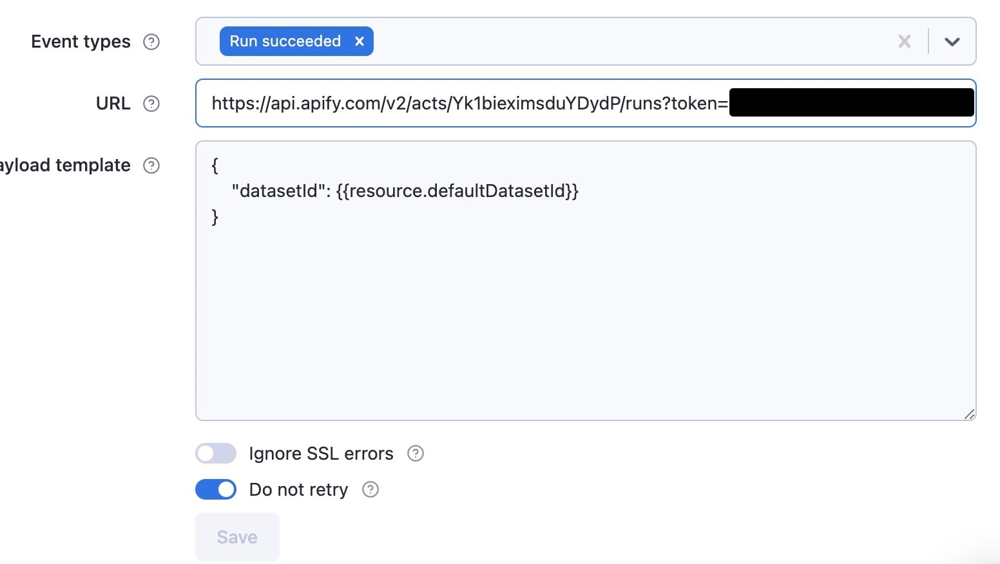
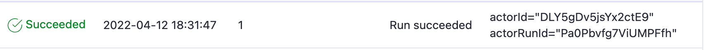
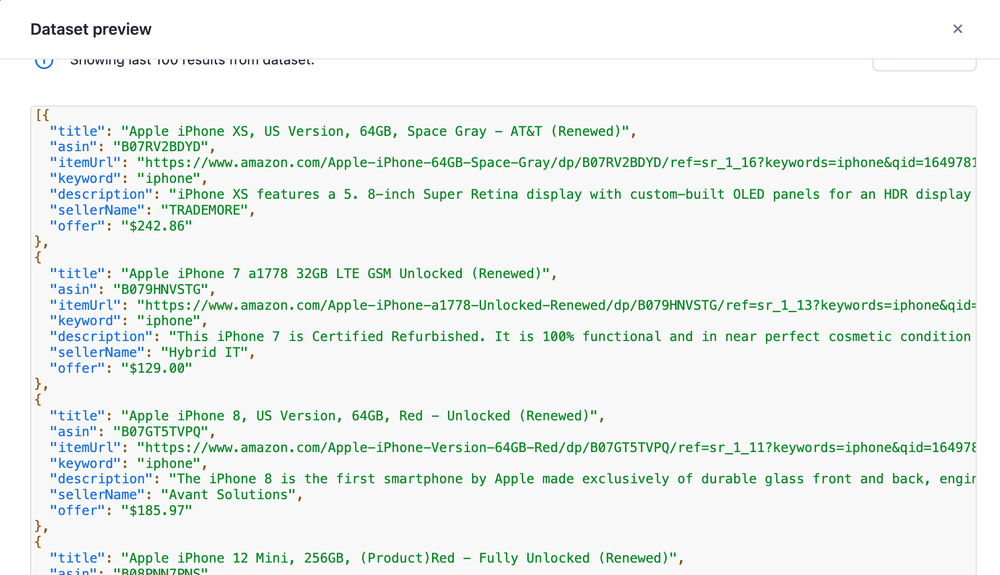

**Learn how to integrate webhooks into your Actors. Webhooks are a super powerful tool, and can be used to do almost anything!**

---

In this lesson we'll be writing a new Actor and integrating it with our beloved Amazon scraping Actor. First, we'll navigate to the same directory where our **academy-amazon-scraper** folder lives, and run `apify create filter-actor` _(once again, you can name the Actor whatever you want, but for this lesson, we'll be calling the new Actor **filter-actor**)_. When asked what you want to build, select **Any use case**:

```text
$ apify create filter-actor
? What do you want to build?
  Web scraper
  AI agent
  API & data pipeline
  Browser automation
 ──────────────
❯ Any use case
```

Then select **JavaScript** as the programming language and use the arrow down key to select **Empty JavaScript Actor**:

```text
$ apify create filter-actor
✔ What do you want to build? Any use case
✔ Choose the programming language of your new Actor: JavaScript
? Choose a template for your new Actor. More info at https://apify.com/templates
  JavaScript site crawler (Crawlee + Cheerio)
  JavaScript one-page scraper (Cheerio)
  JavaScript browser crawler (Crawlee + Puppeteer + Chrome)
  JavaScript browser crawler (Crawlee + Playwright + Chrome)
  JavaScript stealth crawler (Crawlee + Playwright + Camoufox)
  JavaScript minimal site crawler (Crawlee + Cheerio)
  JavaScript test runner (Cypress)
❯ Empty JavaScript Actor
  ...
```

As a last step, when asked how to set up the source code, select **Local only**, and wait until our new Actor is ready.

## Building the new Actor {#building-the-new-actor}

First of all, we should clear out any of the boilerplate code within **main.js** to get a clean slate:

```js
// main.js
import { Actor } from 'apify';

await Actor.init();

// ...

await Actor.exit();
```

We'll be passing the ID of the Amazon Actor's default dataset along to the new Actor, so we can expect that as an input:

```js
const { datasetId } = await Actor.getInput();
const dataset = await Actor.openDataset(datasetId);
// ...
```

:::tip Accessing Cloud Datasets Locally

You will need to use `forceCloud` option - `Actor.openDataset(<name/id>, { forceCloud: true });` - to open dataset from platform storage while running Actor locally.

:::

Next, we'll grab hold of the dataset's items with the `dataset.getData()` function:

```js
const { items } = await dataset.getData();
```

While several methods can achieve the goal output of this Actor, using the [`Array.reduce()`](https://developer.mozilla.org/en-US/docs/Web/JavaScript/Reference/Global_Objects/Array/reduce) is the most concise approach.

Prices are strings like `$1,080.59`, so before comparing them, we need to turn them into numbers. Let's write a small helper function which drops everything except digits and the decimal point:

```js
const parsePrice = (offer) => Number(offer.replace(/[^\d.]/g, ''));
```

Now we can find the cheapest offer for each ASIN:

```js
const filtered = items.reduce((acc, curr) => {
    // Grab the price of the item matching our current
    // item's ASIN in the map. If it doesn't exist, set
    // "prevPrice" to null
    const prevPrice = acc?.[curr.asin] ? parsePrice(acc[curr.asin].offer) : null;

    // Grab the price of our current offer
    const price = parsePrice(curr.offer);

    // If the item doesn't yet exist in the map, add it.
    // Or, if the current offer's price is less than the
    // saved one, replace the saved one
    if (!acc[curr.asin] || prevPrice > price) acc[curr.asin] = curr;

    // Return the map
    return acc;
}, {});
```

The results should be an array, so we can take the map we just created and push an array of its values to the Actor's default dataset:

```js
await Actor.pushData(Object.values(filtered));
```

Our final code looks like this:

```js
import { Actor } from 'apify';

await Actor.init();

const { datasetId } = await Actor.getInput();
const dataset = await Actor.openDataset(datasetId);

const { items } = await dataset.getData();

const parsePrice = (offer) => Number(offer.replace(/[^\d.]/g, ''));

const filtered = items.reduce((acc, curr) => {
    const prevPrice = acc?.[curr.asin] ? parsePrice(acc[curr.asin].offer) : null;
    const price = parsePrice(curr.offer);

    if (!acc[curr.asin] || prevPrice > price) acc[curr.asin] = curr;

    return acc;
}, {});

await Actor.pushData(Object.values(filtered));

await Actor.exit();
```

Cool! But **wait**, don't forget to configure the **.actor/input_schema.json** file as well! New Actors run with [limited permissions](/actors/development/permissions) by default, so they can't read storages they didn't create, such as the dataset of our Amazon scraper. By declaring the `datasetId` input as a dataset with `resourceType` and `resourcePermissions`, we grant the filter Actor read access to the dataset it receives. Both properties are needed, `resourceType` alone isn't enough:

```json
{
    "title": "Amazon Filter Actor",
    "type": "object",
    "schemaVersion": 1,
    "properties": {
        "datasetId": {
            "title": "Dataset ID",
            "type": "string",
            "description": "Enter the ID of the dataset.",
            "editor": "textfield",
            "resourceType": "dataset",
            "resourcePermissions": ["READ"]
        }
    },
    "required": ["datasetId"]
}
```

Now we're done, and we can push it up to the Apify platform with the `apify push` command:

```text
$ apify push
Info: Created Actor with name filter-actor on Apify.
Info: Deploying Actor 'filter-actor' to Apify.
Run: Updated version 0.0 for Actor filter-actor.
Run: Building Actor filter-actor
(timestamp) ACTOR: Extracting Actor documentation from README.md
(timestamp) ACTOR: Building container image (cache enabled).
...
(timestamp) ACTOR: Build finished.
Run: Applying build tag "latest"...
Apify push result: SUCCEEDED
Upload: SUCCEEDED
Build: SUCCEEDED
Actor ID: Yk1bieximsduYDydP
Build ID: kPd2Wq8sXb7RnT4vE
Build number: 0.0.1
Actor URL: https://console.apify.com/actors/Yk1bieximsduYDydP
Build URL: https://console.apify.com/actors/Yk1bieximsduYDydP/builds/0.0.1
```

## Setting up the webhook {#setting-up-the-webhook}

We'll set up the webhook in Apify Console, and the webhook will start the filter Actor by calling the [Apify API](/academy/api/run-actor-and-retrieve-data-via-api). To compose the URL of that HTTP request, we'll need either the ID of our Actor or its technical name. Let's take a second look at the end of the output of the `apify push` command:

```text
...
Actor ID: Yk1bieximsduYDydP
Build ID: kPd2Wq8sXb7RnT4vE
Build number: 0.0.1
Actor URL: https://console.apify.com/actors/Yk1bieximsduYDydP
Build URL: https://console.apify.com/actors/Yk1bieximsduYDydP/builds/0.0.1
```

The output tells us that our Actor's ID is `Yk1bieximsduYDydP`. With this `actorId`, and our `token`, which is retrievable through **Settings > API & Integrations** in Apify Console, we can construct a link which will call the Actor:

```text
https://api.apify.com/v2/actors/Yk1bieximsduYDydP/runs?token=YOUR_TOKEN_HERE
```

We can also use our username and the name of the Actor like this:

```text
https://api.apify.com/v2/actors/USERNAME~filter-actor/runs?token=YOUR_TOKEN_HERE
```

Whichever one you choose is totally up to your preference.

Next, within the Amazon scraping Actor, we will click the **Integrations** tab and choose **Webhook**, then fill out the details to look like this:



We have chosen to run the webhook once the Actor has succeeded, which means that its default dataset will surely be populated. Since the filtering Actor is expecting the default dataset ID of the Amazon Actor, we use the `resource` variable to grab hold of the `defaultDatasetId`. Set the payload template to the following:

```text
{"datasetId": {{resource.defaultDatasetId}}}
```

Don't put quotes around the variable. Apify fills in the value already as a JSON string, so with quotes, the filter Actor would receive the literal text `{{resource.defaultDatasetId}}` instead of the dataset ID.

Click **Save**, then run the **academy-amazon-scraper** Actor again.

## Making sure it worked {#checking-the-webhook}

If everything worked, then at the end of the **academy-amazon-scraper** run, we should see this within the **Integrations** tab:



Additionally, we should be able to see that our **filter-actor** was run, and have access to its dataset:



## Quiz answers 📝 {#quiz-answers}

**Q: How do you allocate more CPU for an Actor's run?**

**A:** On the platform, more memory can be allocated in the Actor's input configuration, and the default allocated CPU can be changed in the Actor's **Settings** tab. When running locally, you can use the **APIFY_MEMORY_MBYTES** environment variable to set the allocated CPU. 4GB is equal to 1 CPU core on the Apify platform.

**Q: Within itself, can you get the exact time that an Actor was started?**

**A:** Yes. The time the Actor was started can be retrieved through the `startedAt` property from the `Actor.getEnv()` function, or directly from `process.env.APIFY_STARTED_AT`

**Q: What are the types of default storages connected to an Actor's run?**

Every Actor's run is given a default key-value store and a default dataset. The default key-value store by default has the `INPUT` and `OUTPUT` keys. The Actor's request queue is also stored.

**Q: Can you change the allocated memory of an Actor while it's running?**

**A:** Not while it's running. You'd need to stop it and run a new one. However, there is an option to soft abort an Actor, then resurrect then run with a different memory configuration.

**Q: How can you run an Actor with Puppeteer on the Apify platform with headless mode set to `false`?**

**A:** This can be done by using the `actor-node-puppeteer-chrome` Docker image and making sure that `launchContext.launchOptions.headless` in `PuppeteerCrawlerOptions` is set to `false`.

## Wrap up {#wrap-up}

See that?! Integrating webhooks is a piece of cake on the Apify platform! You'll soon discover that the platform factors away a lot of complex things and allows you to focus on what's most important - developing and releasing Actors.
