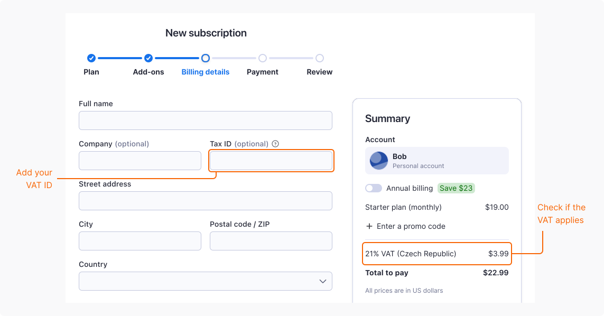

If you have a registered business with a valid tax identification number, you can get invoices without VAT.

Note that if your billing country is Czechia, VAT always applies, because Apify is a Czech-based company.

## Add your VAT ID

To receive invoices without VAT, provide your tax identification number when [subscribing to an Apify plan](/account/subscriptions#subscribe).

Your VAT ID is verified immediately and, if accepted, the VAT amount is removed from the billing summary. The invoice is generated right after you complete the subscription process.

To make sure your VAT ID is accepted:

- Add the country code at the beginning. For example, DE123456789.
- Use the official format of your ID exactly as registered.
- Double-check your input for extra spaces or typos.

### If your VAT ID is rejected

If your VAT ID gets rejected and it's from a European Union country, check the VAT number using the official EU VIES tool. If the number is valid, [contact support](http://apify.com/contact) and include the following information in your message:

- The VAT ID you're trying to use.
- A screenshot of the VIES validation result.

If your VAT ID is from a country outside the European Union, [contact support](http://apify.com/contact).

## Update your VAT ID

To add or update your VAT ID when you already have a subscription:

1. Log in to [Apify Console](https://console.apify.com).
1. In the left-side panel, go to **Billing**.
1. Select the **Subscription** tab.
1. In the **Billing details** section, select **Edit**.
1. In the **Tax ID** field, enter your VAT ID.

The change applies to future invoices only. Due to accounting regulations, Apify can't retroactively update invoices that have already been issued.

