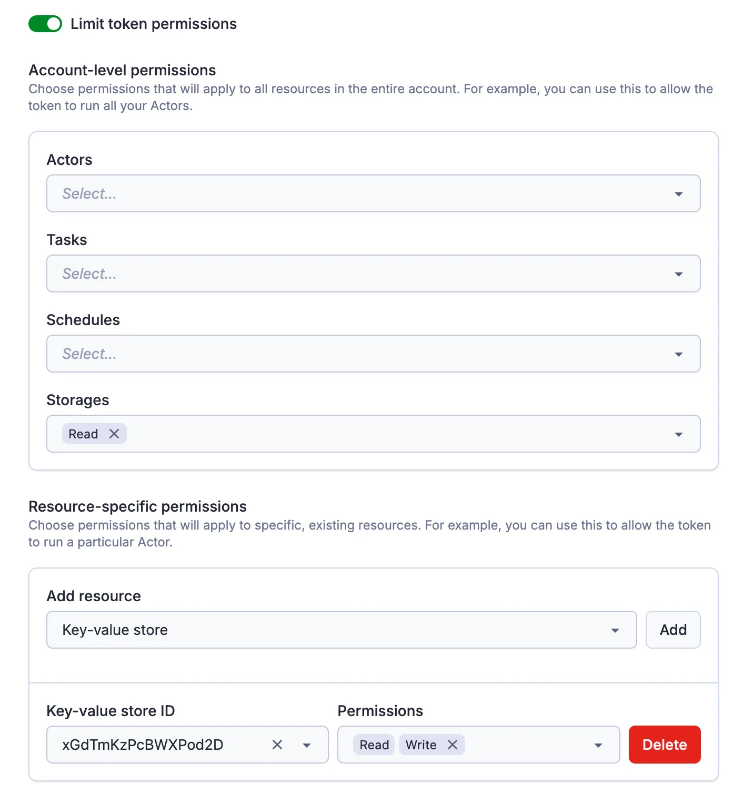

To access the Apify API in your integrations, you need to authenticate using your secret API token. You manage your tokens on the [API & Integrations](https://console.apify.com/settings/integrations) page in Apify Console. A new personal account has no API token, so [create one](#create-api-token) before your first API call.

Apify Console shows the value of an API token only once, right after you create or [rotate](#rotation) it. The token list shows each token's name, a masked preview of its value, when it was last used, and when it expires. You can't view or copy the full value of an existing token. Use the preview to tell your tokens apart.

The Apify CLI doesn't need a copied token. When you sign in with [`apify login`](/cli/docs/reference#apify-auth-login--apify-login) in the browser, the sign-in creates a token for your device, and the CLI stores it for you.

When a token is created or rotated on your account, Apify sends you an email and a notification in Apify Console. This includes tokens that `apify login` creates. If you don't recognize the token, secure your account in **Settings > Login & Privacy** and delete the token.

:::caution Protect your API token
Unless you fully understand the consequences, don't share your API token with untrusted parties or use it directly in client-side code. You can also [limit the token's permissions](#limited-permissions) so that it can access only what it needs.
:::

## Create an API token {#create-api-token}

1. Go to [**Settings > API & Integrations**](https://console.apify.com/settings/integrations) in Apify Console.
1. In the **Personal API tokens** section, select **Create a new token**.
1. Enter a name that says where you will use the token. Optionally, add a description.
1. In **Expiration**, keep the default of **90 days** or [choose another option](#expiration).
1. Optionally, [limit the token's permissions](#limited-permissions).
1. Select **Create**.
1. Copy the token and store it somewhere safe, such as a password manager.
1. Select **Done**.

If you lose a token, [rotate it](#rotation) to get a new value, or create a new token and delete the old one. You can delete any token, including your last one.

## Expiration

A token you create in Apify Console expires after 90 days unless you choose otherwise. An expired token stops working, which limits the damage if the token leaks. In the **Expiration** field of the token form, choose one of these options:

- If you choose **7 days**, **30 days**, **90 days**, or **365 days**, the token lasts that many full days and then expires at the next 00:00 UTC. A 90-day token therefore lasts between 90 and 91 days.
- If you choose **Custom date**, the token expires at 00:00 UTC at the start of the day you pick.
- If you choose **No expiration**, the token works until you delete or rotate it.

The token list shows the exact time each token expires, for example `Expires on February 15, 2027, 00:00 UTC`. To change the expiration of an existing token, edit the token and pick a new date, or clear the date to remove the expiration.

The 90-day default applies only to the token form. A token that `apify login` creates has no expiration.

## Rotation

If you suspect that a token is compromised or exposed, you can rotate it in Apify Console. Apify Console creates the new token right away. When you rotate a token, you can keep the old token active for 24 hours. Update every application that uses the old token before then, because after the 24 hours it stops working.

After you confirm the rotation, Apify Console shows the new token. This is the only time you can copy it, so store it somewhere safe. The new token has no [expiration](#expiration), even if the old one had. To set an expiration, edit the token and pick a date.

Apify Console marks tokens identified as compromised with a **Leaked** label, so that you can find them and act on them.

## Good practices

Treat an API token like a password:

- Use a separate token for each service, as you would use a separate password for each account.
- Give each token a name that says where you use it.
- [Limit the token's permissions](#limited-permissions) to what the service needs.
- Keep an [expiration](#expiration) on tokens you share with third-party services or use for temporary access.
- [Rotate](#rotation) a token as soon as you suspect it's exposed.

## Organization accounts

When you work under an organization account, the API & Integrations page shows two types of API tokens.

Personal API tokens in an organization are separate from the tokens of your personal account. If you use a personal token in an integration, it has the same permissions that you have within the organization. Apify ascribes every operation you use it for to you. When you join or create an organization, Apify creates one personal token for you in that organization. This token has no expiration. A personal token stops working when you leave the organization.

Organization API tokens have full permissions and are not tied to a specific member of the organization. You can access them only if you are the owner or have the **Manage access tokens** permission.

## API tokens with limited permissions {#limited-permissions}

By default, a token can access all data in your account. To restrict a token to the data that a particular use case needs, limit its permissions. A token with limited permissions is called a _scoped_ token. A scoped token can access only the resources that you explicitly allow.

Scoped tokens can't create or modify Actors. To create or modify Actors through the Apify API, use an unscoped token.

### Create a scoped token

Scoped tokens behave like standard API tokens. You manage them on the [API & Integrations](https://console.apify.com/settings/integrations) page in Apify Console. When you create or edit a token, turn on **Limit token permissions** to make the token scoped. Then specify the token's permissions.

### Account-level vs resource-specific permissions

A token's permissions come in two types:

- Account-level permissions apply to all resources in the account. For example, they can allow the token to run all your Actors.
- Resource-specific permissions apply only to specific, existing resources. For example, they can allow the token to read from one dataset.

A single token can combine both types. For example, a token can read any storage but write to only one key-value store.

### Allow tokens to create resources

To create new resources with the token, such as a task or a storage, you need to allow that explicitly.

After the token creates a resource, the token has full access to that resource, regardless of its other permissions. You can't create a token that can create a dataset but can't write to it.

For example, a token can create and populate datasets without access to the other datasets in your account.

### Permission dependencies

Some permissions require other permissions alongside them. These are called _permission dependencies_.

#### Automatic dependencies

The form enforces some dependencies automatically. For example, when you grant the **Write** permission for a dataset, the form also selects the **Read** permission. A token that can write to a dataset can therefore also read from it.

#### Manual dependencies

Other dependencies are more complex, so you need to configure them yourself:

- To create or update a schedule, the token needs access to the schedule and to the Actor or task that the schedule runs: the **Run** permission on the Actor, or the **Read** permission on the task.
- To create, update, or run a task, the token needs the **Run** permission on the task's Actor.

For example, to create schedules for one Actor programmatically, give the token two permissions: the account-level **Create** permission on schedules, and the resource-specific **Run** permission on that Actor. Such a token has the permissions it needs and no more.

### Actor execution

When you run an Actor, Apify creates a short-lived run API token and injects it into the Actor's environment. This also applies to scoped tokens. An Actor that you run with a scoped token therefore runs with a different token, which has a different scope.

In the scoped token's configuration, you choose the scope of the run API token. That scope determines what the Actor can access during its run. Apify supports two modes:

- With **Full access**, Actors can access all your account's data.
- With **Restricted access**, Actors can access only what the scoped token's scope allows.

#### Full access

When you run an Actor with a scoped token in this mode, Apify injects an _unscoped_ token into the Actor's runtime.

After you allow a token to run an Actor, the run therefore works whatever permissions the Actor needs. However, you need to trust the Actor.

Use this mode to let a third-party service run your Actors. Create a scoped token that can run only the Actor you need, and share it with the service. If the token leaks, it can't be used to access your other data.

#### Restricted access

When you run an Actor with a scoped token in this mode, Apify injects a token with the same scope as the original token.

Actors therefore can't access data they shouldn't, by accident or on purpose. However, an Actor might not work properly if the scope is insufficient.

The restriction is transitive: if the Actor runs another Actor, that Actor's access is restricted as well.

:::caution Server Actors limitation
[Server Actors](/actors/running/server-actors) don't support restricted access mode. You can send requests to a Server Actor with a scoped token configured for restricted access, but Apify doesn't guarantee that it works.
:::

#### Default run storages

When Apify [runs an Actor](/actors/running/runs-and-builds#runs), it creates a set of default storages that the Actor can use: a dataset, a key-value store, and a request queue.

You can configure whether the scoped token you use to run the Actor gets access to these default storages.

If the toggle is on, the token can read and write to the default storages of the Actor runs it starts, without an explicit permission. It can also read the default storages of other runs that it can access through the **List runs** permission on an Actor. Use this to let a third-party service, such as an AI agent, run an Actor and then read its output.

If the toggle is off, the token can still trigger and inspect runs, but its access to the default storages is restricted:

- In an account with **Restricted** [general resource access](/account/collaboration/general-resource-access), the token can't read or write to default storages.
- In an account with **Unrestricted** general resource access, the default storages can still be read anonymously using their IDs, but the token can't write to them.

For example, your Actor might produce data that you want to delete right after the run finishes. Turn the toggle on so that the scoped token can delete that data.

#### Full-permission Actors

The **Allow this token to run full-permission Actors** setting controls whether the scoped token can run [full-permission Actors](/actors/running/permissions#full-permission-actors). The setting is on by default. Before you can run a full-permission Actor through the API, you still need to approve it in Apify Console.

### Schedules

You can use scoped tokens to schedule Actors and tasks. Each schedule invocation triggers a new Actor run, and Apify creates a run API token and injects it into the Actor.

**This run token is always unscoped.** The scheduled Actor can therefore access all your account's data, whatever the scope of the token that created the schedule.

### Webhooks configuration

A token that can run an Actor can also manage the Actor's webhooks. The same applies to tasks.

When a webhook points to the Apify API, the Apify platform injects a token when it dispatches the webhook. If you set up such a webhook with a scoped token, the platform dispatches it with a token that has the same limited permissions.

The token therefore needs permissions to set up the webhook and to perform the webhook's operation. For example, take a webhook that pushes an item to a dataset each time an Actor run succeeds. The token needs to run the Actor, which lets it create the webhook, and to write to that dataset.

### Troubleshooting

#### Allow a token to run a task

Tasks have no dedicated **Run** permission. Give the token these permissions instead:

- **Run** on the Actor that the task runs
- **Read** on the task

For details, see [permission dependencies](#permission-dependencies).

#### A run fails with `insufficient permissions` in the log

This error usually means that the Actor runs with a scoped token set to **Restricted access**.

The Actor is trying to access a resource, such as a dataset or a key-value store, or to perform an operation that the token's scope doesn't allow.

If you know which permission is missing, add it to the token's scope. If you don't, switch the token's permission mode to **Full access**, which lets the Actor access all your account's data.

For details, see [Actor execution](#actor-execution).
