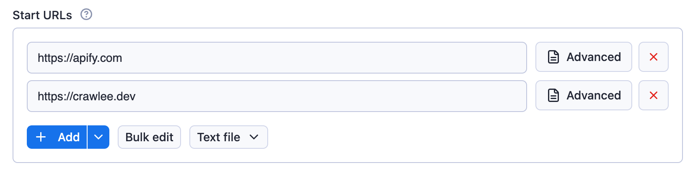
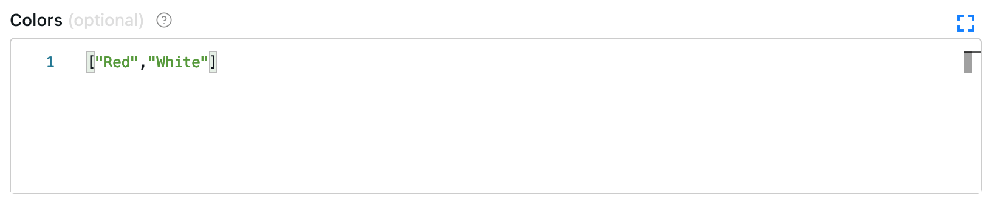
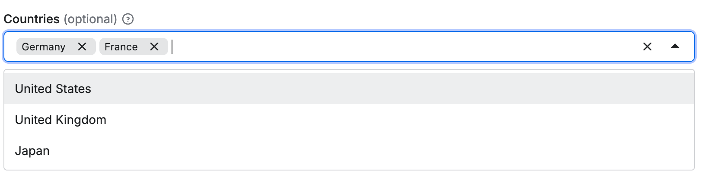
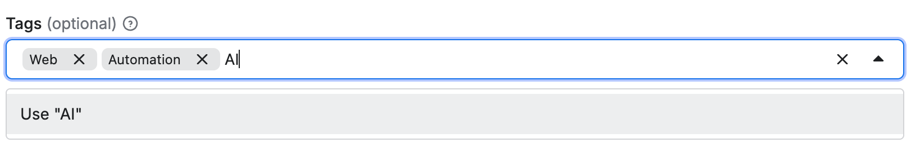
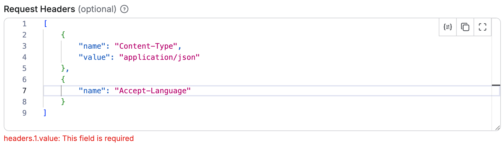
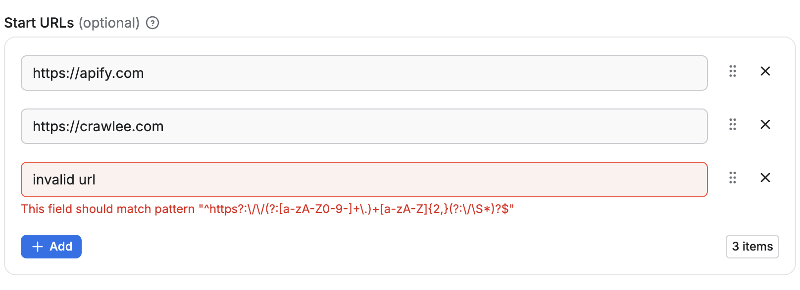
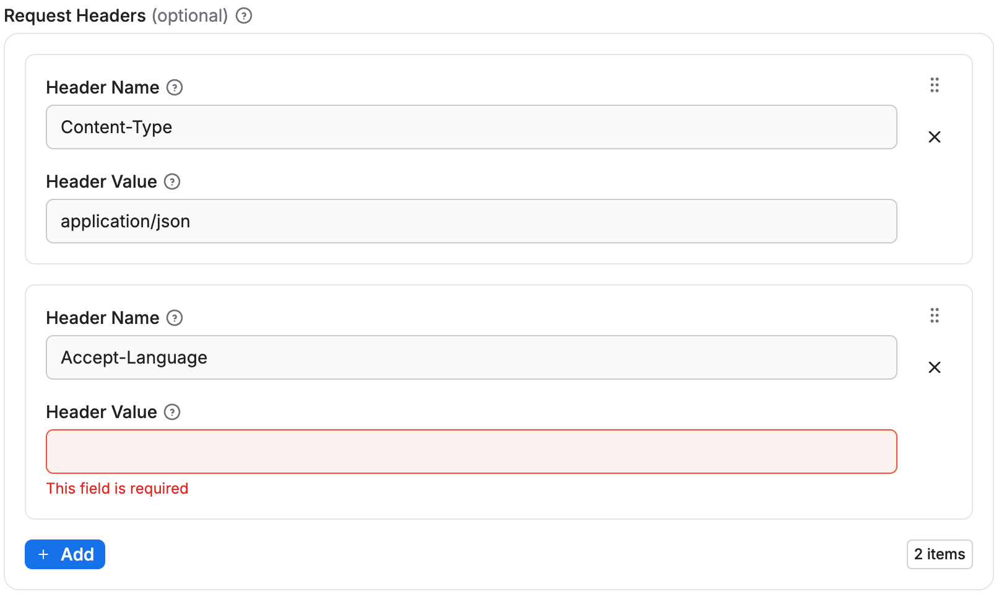

Array fields hold a list of values. The editor decides how users enter them, from a URL list to key-value pairs or a multiselect, and an optional `items` sub-schema validates each item.

Example of request list sources configuration:

```json
{
    "title": "Start URLs",
    "type": "array",
    "description": "URLs to start with",
    "prefill": [{ "url": "https://apify.com" }],
    "editor": "requestListSources"
}
```

Rendered input:



Example of an array:

```json
{
    "title": "Colors",
    "type": "array",
    "description": "Enter colors you know",
    "prefill": ["Red", "White"],
    "editor": "json"
}
```

Rendered input:



Properties:

| Property           | Value                                                                                                                                                                                                                  | Required | Description                                                                                                                                                                                                                                     |
|--------------------|------------------------------------------------------------------------------------------------------------------------------------------------------------------------------------------------------------------------|----------|-------------------------------------------------------------------------------------------------------------------------------------------------------------------------------------------------------------------------------------------------|
| `editor`           | One of <ul><li>`json`</li><li>`requestListSources`</li><li>`pseudoUrls`</li><li>`globs`</li><li>`keyValue`</li><li>`stringList`</li><li>`fileupload`</li><li>`select`</li><li>`schemaBased`</li><li>`hidden`</li></ul> | Yes      | UI editor used for input.                                                                                                                                                                                                                       |
| `placeholderKey`   | String                                                                                                                                                                                                                 | No       | Placeholder displayed for <br/>key field when no value is specified. Works only with `keyValue` editor.                                                                                                                                         |
| `placeholderValue` | String                                                                                                                                                                                                                 | No       | Placeholder displayed in value field <br/>when no value is provided. Works only with `keyValue` and <br/>`stringList` editors.                                                                                                                  |
| `maxItems`         | Integer                                                                                                                                                                                                                | No       | Maximum number of items <br/>the array can contain.                                                                                                                                                                                             |
| `minItems`         | Integer                                                                                                                                                                                                                | No       | Minimum number of items <br/>the array can contain.                                                                                                                                                                                             |
| `uniqueItems`      | Boolean                                                                                                                                                                                                                | No       | Specifies whether the array <br/>should contain only unique values.                                                                                                                                                                             |
| `nullable`         | Boolean                                                                                                                                                                                                                | No       | Specifies whether null is <br/>an allowed value.                                                                                                                                                                                                |
| `items`            | object                                                                                                                                                                                                                 | No       | Specifies format of the items of the array, useful mainly for multiselect and for `schemaBased` editor (see below).                                                                                                                             |
| `isSecret`         | Boolean                                                                                                                                                                                                                | No       | Specifies whether the input field will be stored encrypted. Only available with `json` and `hidden` editors.                                                                                                                                    |

Usage of this field is based on the selected editor:

- `requestListSources` - value from this field can be used as input for the [RequestList](https://crawlee.dev/api/core/class/RequestList) class from Crawlee.
- `pseudoUrls` - is intended to be used with a combination of the [PseudoUrl](https://crawlee.dev/api/core/class/PseudoUrl) class and the [enqueueLinks()](https://crawlee.dev/api/core/function/enqueueLinks) function from Crawlee.

Editor type `requestListSources` supports input in formats defined by the [sources](https://crawlee.dev/api/core/interface/RequestListOptions#sources) property of [RequestListOptions](https://crawlee.dev/api/core/interface/RequestListOptions).

Editor type `globs` maps to the Crawlee's [GlobInput](https://crawlee.dev/api/core#GlobInput) used by the [UrlPatterObject](https://crawlee.dev/api/core#UrlPatternObject).

Editor type `fileupload` enables users to specify a list of files as input. The input is passed to the Actor as an array of strings. The Actor author is responsible for interpreting the strings, including validating file existence and format. This editor simplifies the process for users to upload files to a key-value store of their choice.

## Select editor for arrays

The `select` editor for arrays allows users to pick multiple items from a dropdown list. This creates a multiselect field in the UI.
You can either only allow users to select from a set of predefined values, or allow them to specify custom values in addition to suggested values.

To correctly define options for multiselect, you need to define the `items` property and then provide values in `enum`/`enumSuggestedValues` and (optionally) labels in `enumTitles` properties.

### Select from predefined values

When you need to restrict selections to a specific set of values, use the `enum` property:

```json
{
    "title": "Countries",
    "description": "Select multiple countries",
    "type": "array",
    "editor": "select",
    "items": {
        "type": "string",
        "enum": ["us", "de", "fr", "uk", "jp"],
        "enumTitles": ["United States", "Germany", "France", "United Kingdom", "Japan"]
    }
}
```

This creates a multiselect dropdown where users can only select from the predefined values:



### Select with custom input

When you want to suggest values but still allow custom input, use the `enumSuggestedValues` property:

```json
{
    "title": "Tags",
    "description": "Select or enter custom tags",
    "type": "array",
    "editor": "select",
    "items": {
        "type": "string",
        "enumSuggestedValues": ["web", "scraping", "automation", "data", "api"],
        "enumTitles": ["Web", "Scraping", "Automation", "Data", "API"]
    }
}
```

This creates a multiselect dropdown with suggested values, but users can also enter custom values:



## Array items validation

Arrays in the input schema can define an `items` field to specify the type and validation rules for each item.
Each array item is validated according to its `type` and inside the `items` field it's also possible to define additional validation rules such as `pattern`, `minimum`, `maximum`, etc., depending on the item type.

If the item type is an `object`, it can define its own `properties`, `required`, and `additionalProperties` fields,
working in the same way as a single object field (see [Object fields validation](./object.md#object-fields-validation)).

Validation is performed both in the UI and during Actor execution via the API.
Array items can themselves be objects with sub-schemas, and objects within objects, recursively, without any limit on nesting depth.

```json title="Example of an array of objects property with sub-schema"
{
    "title": "Request Headers",
    "type": "array",
    "description": "List of custom HTTP headers",
    "editor": "json",
    "items": {
        "type": "object",
        "properties": {
            "name": {
                "title": "Header Name",
                "description": "Name of the HTTP header",
                "type": "string",
                "minLength": 1
            },
            "value": {
                "title": "Header Value",
                "description": "Value of the HTTP header",
                "type": "string",
                "minLength": 1
            }
        },
        "required": ["name", "value"],
        "additionalProperties": false
    },
    "minItems": 1,
    "maxItems": 20
}
```

Rendered input:


In this example:

- The array must contain between 1 and 20 items.
- Each item must be an object with `name` and `value` properties.
- Both `name` and `value` are required.
- No additional properties beyond those defined are allowed.
- The validation of each object item works the same as for a single object field (see [Object fields validation](./object.md#object-fields-validation)).

### Handling default and prefill values array with object sub-properties

When defining an array of objects with sub-properties, it's possible to set `default` and `prefill` values in two ways:

1. _At the parent array level_: You can provide an array of complete objects as the `default` or `prefill` value, which will be used only if there is no value specified for the field.
2. _At the individual sub-property level_: You can specify `default` or `prefill` values for each sub-property within the `properties` definition of the object items. These values will be applied to each object in the array value.

For example, having an input schema like this:

```json
{
    "title": "Requests",
    "type": "array",
    "description": "List of HTTP requests",
    "editor": "schemaBased",
    "default": [
        { "url": "https://apify.com", "port": 80 }
    ],
    "items": {
        "type": "object",
        "properties": {
            "url": {
                "title": "URL",
                "type": "string",
                "description": "Request URL",
                "editor": "textfield"
            },
            "port": {
                "title": "Port",
                "type": "integer",
                "description": "Request port",
                "editor": "number",
                "default": 8080
            }
        },
        "required": ["url", "port"],
        "additionalProperties": false
    }
}
```

If there is no value specified for the field, the array will default to containing one object:

```json
[
    { "url": "https://apify.com", "port": 80 }
]
```

However, if the user adds a new item to the array, the `port` sub-property of that new object will default to `8080`, as defined in the sub-property itself.

## `schemaBased` editor

Arrays can use the `schemaBased` editor to provide a user-friendly interface for editing each item individually.
It works for arrays of primitive types (like strings or numbers) as well as arrays of objects, rendering each item according to its type and optional `editor` configuration.

This makes it easy to manage complex arrays in the UI while still enforcing validation rules defined in the items field.

```json title="Example of an array of strings property with sub-schema"
{
    "title": "Start URLs",
    "type": "array",
    "description": "List of URLs for the scraper to visit",
    "editor": "schemaBased",
    "items": {
        "type": "string",
        "pattern": "^https?:\\/\\/(?:[a-zA-Z0-9-]+\\.)+[a-zA-Z]{2,}(?:\\/\\S*)?$"
    },
    "minItems": 1,
    "maxItems": 50,
    "uniqueItems": true
}
```

Rendered input:


- Each item is rendered as a text field.
- The array must contain between 1 and 50 items.
- Duplicate values are not allowed.

```json title="Example of an array of objects property with sub-schema"
{
    "title": "Request Headers",
    "type": "array",
    "description": "List of custom HTTP headers",
    "editor": "schemaBased",
    "items": {
        "type": "object",
        "properties": {
            "name": {
                "title": "Header Name",
                "description": "Name of the HTTP header",
                "type": "string",
                "minLength": 1,
                "editor": "textfield"
            },
            "value": {
                "title": "Header Value",
                "description": "Value of the HTTP header",
                "type": "string",
                "minLength": 1,
                "editor": "textfield"
            }
        },
        "required": ["name", "value"],
        "additionalProperties": false
    },
    "minItems": 1,
    "maxItems": 20
}
```

Rendered input:


- Each array item is represented as a group of input fields (`name` and `value`).
- Validation ensures all required sub-properties are filled and no extra properties are allowed.
- New items can be added up to the `maxItems` limit, and each item is validated individually.

### Limitations

As with objects, the sub-schema feature for arrays only works for level 1 sub-properties. While the objects in the array can have properties with their own schema definitions, those properties cannot themselves use the `schemaBased` editor.
