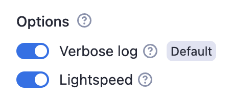
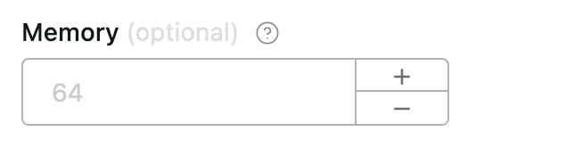

Boolean fields render as checkboxes and can be grouped under a caption. Numeric fields come in two types, `integer` and `number`, and can carry a range and a unit.

## Boolean type

Example options with group caption:

```json5
{
    "verboseLog": {
        "title": "Verbose log",
        "type": "boolean",
        "description": "Debug messages will be included in the log.",
        "default": true,
        "groupCaption": "Options",
        "groupDescription": "Various options for this Actor"
    },
    "lightspeed": {
        "title": "Lightspeed",
        "type": "boolean",
        "description": "If checked then actors runs at the
            speed of light.",
        "prefill": true
    }
}
```

Rendered input:



Properties:

| Property | Value | Required | Description |
| --- | --- | --- | --- |
| `editor` | One of <ul><li>`checkbox`</li><li>`hidden`</li></ul> | No | Visual editor used for the input field. |
| `groupCaption` | String | No | If you want to group <br/>multiple checkboxes together, <br/>add this option to the first <br/>of the group. |
| `groupDescription` | String | No | Description displayed as help text <br/>displayed of group title. |
| `nullable` | Boolean | No | Specifies whether null is <br/>an allowed value. |

## Numeric types

There are two numeric types supported in the input schema: `integer` and `number`.

- The `integer` type represents whole numbers.
- The `number` type can represent both integers and floating-point numbers.

Example:

```json
{
    "title": "Memory",
    "type": "integer",
    "description": "Select memory in megabytes",
    "default": 64,
    "maximum": 1024,
    "unit": "MB"
}
```

Rendered input:



Properties:

| Property   | Value                                               | Required | Description                                                                   |
|------------|-----------------------------------------------------|----------|-------------------------------------------------------------------------------|
| `type`     | One of <ul><li>`integer`</li><li>`number`</li></ul> | Yes      | Defines the type of the field - either an integer or a floating-point number. |
| `editor`   | One of: <ul><li>`number`</li><li>`hidden`</li></ul> | No       | Visual editor used for input field.                                           |
| `maximum`  | Integer or Number <br/>(based on the `type`)        | No       | Maximum allowed value.                                                        |
| `minimum`  | Integer or Number <br/>(based on the `type`)        | No       | Minimum allowed value.                                                        |
| `unit`     | String                                              | No       | Unit displayed next to the field in UI, <br/>for example _second_, _MB_, etc. |
| `nullable` | Boolean                                             | No       | Specifies whether null is an allowed value.                                   |
