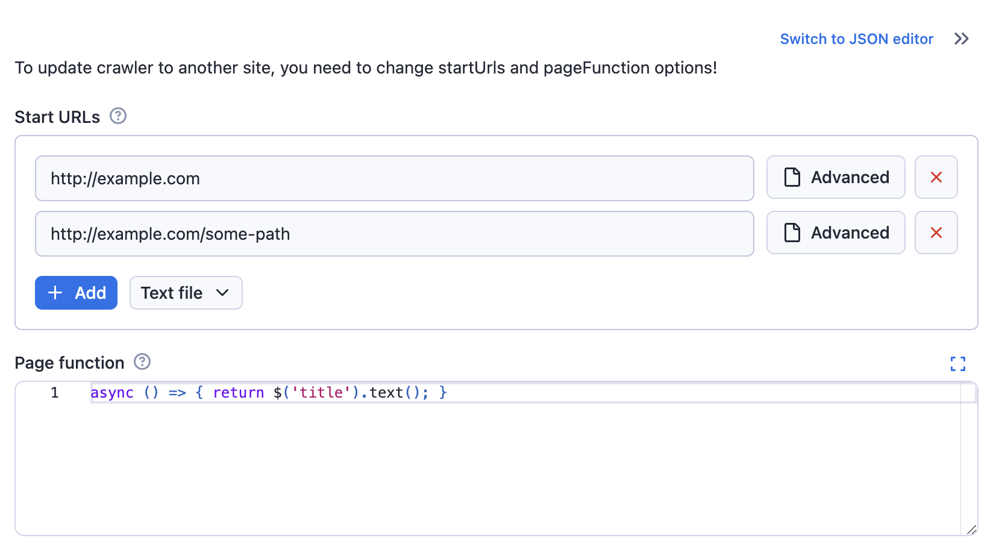

Actor input schema is a JSON file which defines the schema and description of the input object and its properties accepted by the Actor on start. The file adheres to [JSON schema](https://json-schema.org/) with our extensions, and describes a single Actor input object and its properties, including documentation, default value, and user interface definition.

The Actor input schema file is used to:

- Validate the passed input JSON object on Actor run, so that Actors don't need to perform input validation and error handling in their code.
- Render user interface for Actors to make it easy for users to run and test them manually.
- Generate Actor API documentation and integration code examples on the web or in CLI, making Actors easy to integrate for users.
- Simplify integration of Actors into automation workflows such as Zapier or Make, by providing smart connectors that smartly pre-populate and link Actor input properties.

To define an input schema for an Actor, set `input` field in the `.actor/actor.json` file to an input schema object (described below), or path to a JSON file containing the input schema object.
For backwards compatibility, if the `input` field is omitted, the system looks for an `INPUT_SCHEMA.json` file either in the `.actor` directory or the Actor's top-level directory - but note that this functionality is deprecated and might be removed in the future. The maximum allowed size for the input schema file is 500 kB.

When you provide an input schema, the Apify platform will validate the input data passed to the Actor on start (via the API or Apify Console) to ensure compliance before starting the Actor.
If the input object doesn't conform the schema, the caller receives an error and the Actor is not started.

:::note Validation aid

You can use our [visual input schema editor](https://apify.github.io/input-schema-editor-react/) to guide you through the creation of the `INPUT_SCHEMA.json` file.

To ensure the input schema is valid, here's a corresponding [JSON schema file](https://github.com/apify/apify-shared-js/blob/master/packages/json_schemas/schemas/input.schema.json).

You can also use the [`apify validate-schema`](/cli/docs/reference#apify-validate-schema-path) command in the Apify CLI.

:::

## Example

Imagine a simple web crawler that accepts an array of start URLs and a JavaScript function to execute on each visited page. The input schema for such a crawler could be defined as follows:

```json5
{
    "title": "Cheerio Crawler input",
    "description": "To update crawler to another site, you need to change startUrls and pageFunction options!",
    "type": "object",
    "schemaVersion": 1,
    "properties": {
        "startUrls": {
            "title": "Start URLs",
            "type": "array",
            "description": "URLs to start with",
            "prefill": [
                { "url": "http://example.com" },
                { "url": "http://example.com/some-path" }
            ],
            "editor": "requestListSources"
        },
        "pageFunction": {
            "title": "Page function",
            "type": "string",
            "description": "Function executed for each request",
            "prefill": "async () => { return $('title').text(); }",
            "editor": "javascript"
        }
    },
    "required": ["startUrls", "pageFunction"]
}
```

The generated input UI will be:



If you switch the input to the **JSON** display using the toggle, then you will see the entered input stringified to `JSON`, as it will be passed to the Actor:

```json
{
    "startUrls": [
    {
        "url": "http://example.com"
    },
    {
        "url": "http://example.com/some-path"
    }
    ],
    "pageFunction": "async () => { return $('title').text(); }"
}
```

## Structure

```json
{
    "title": "Cheerio Crawler input",
    "type": "object",
    "schemaVersion": 1,
    "properties": { /* define input fields here */ },
    "required": []
}
```

| Property | Type | Required | Description |
| --- | --- | --- | --- |
| `title` | String | Yes | Any text describing your input schema. |
| `description` | String | No | Help text for the input that will be <br/>displayed above the UI fields. |
| `type` | String | Yes | This is fixed and must be set <br/>to string `object`. |
| `schemaVersion` | Integer | Yes | The version of the input schema <br/>specification against which <br/>your schema is written. Currently, only version `1` is out. |
| `properties` | Object | Yes | This is an object mapping each field key <br/>to its specification. |
| `required` | String | No | An array of field keys that are required. |
| `additionalProperties` | Boolean | No | Controls if properties not listed in `properties` are allowed. Defaults to `true`. <br/>Set to `false` to make requests with extra properties fail. |

:::note Input schema differences

Even though the structure of the Actor input schema is similar to JSON schema, there are some differences. We cannot guarantee that JSON schema tooling will work on input schema documents. For a more precise technical understanding of the matter, feel free to browse the code of the [@apify/input_schema](https://github.com/apify/apify-shared-js/tree/master/packages/input_schema/src) package.

:::

## Input fields

Each field of your input is described under its key in the `inputSchema.properties` object. The field might have `integer`, `string`, `array`, `object`, or `boolean` type, and its specification contains the following properties:

| Property | Value | Required | Description |
| --- | --- | --- | --- |
| `type` | One of <ul><li>`string`</li><li>`array`</li><li>`object`</li><li>`boolean`</li><li>`integer`</li></ul> | Yes | Allowed type for the input value. <br/>Cannot be mixed. |
| `title` | String | Yes | Title of the field in UI. |
| `description` | String | Yes | Description of the field that will be <br/>displayed as help text in Actor input UI. |
| `default` | Must match `type` property. | No | Default value that will be <br/>used when no value is provided. |
| `prefill` | Must match `type` property. | No | Value that will be prefilled <br/>in the Actor input interface. |
| `example` | Must match `type` property. | No | Sample value of this field <br/>for the Actor to be displayed when <br/>Actor is published in Apify Store. |
| `errorMessage` | Object | No | Custom error messages for validation keywords. <br/>See [custom error messages](../custom_error_messages.md) <br/>for more details. |
| `sectionCaption` | String | No | If this property is set, <br/>then all fields following this field <br/>(this field included) will be separated <br/>into a collapsible section <br/>with the value set as its caption. The section ends at the last field <br/>or the next field which has the <br/> `sectionCaption` property set. |
| `sectionDescription` | String | No | If the `sectionCaption` property is set, <br/>then you can use this property to <br/>provide additional description to the section. <br/>The description will be visible right under <br/>the caption when the section is open. |

### Prefill vs. default vs. required

Here is a rule of thumb for whether an input field should have a `prefill`, `default`, or be required:

- **Prefill** - Use for fields that don't have a reasonable default. The provided value is prefilled for the user to show them an example of using the field and to make it easy to test the Actor (e.g., search keyword, start URLs). In other words, this field is only used in the user interface but does not affect the Actor functionality and API. Note that if you add a new input option to your Actor, the Prefill value won't be used by existing integrations such as Actor tasks or API calls, but the Default will be if specified. This is useful for keeping backward compatibility when introducing a new flag or feature that you prefer new users to use.
- **Required** - Use for fields that don't have a reasonable default and MUST be entered by the user (e.g., API token, password).
- **Default** - Use for fields that MUST be set for the Actor run to some value, but where you don't need the user to change the default behavior (e.g., max pages to crawl, proxy settings).
  If the user omits the value when starting the Actor via any means (API, CLI, scheduler, or user interface), the platform automatically passes the Actor this default value.
- **No particular setting** - Use for purely optional fields where it makes no sense to prefill any value (e.g., flags like debug mode or download files).

In summary, you can use each option independently or use a combination of **Prefill + Required** or **Prefill + Default**, but the combination of **Default + Required** doesn't make sense to use.

## Input types

Most types also support additional properties defining, for example, the UI input editor. Each type has its own page with its editors, validation properties, and examples:

| Type | Editors | Typical use |
| --- | --- | --- |
| [String](./string.md) | `textfield`, `textarea`, `javascript`, `python`, `select`, `datepicker`, `fileupload`, `hidden` | Text, code, dates, single choice, one file |
| [Boolean and numeric](./boolean-and-numeric.md) | `checkbox`, `number`, `hidden` | Flags and option groups, integers and floating-point numbers with units and ranges |
| [Object](./object.md) | `json`, `proxy`, `schemaBased`, `hidden` | Proxy configuration, free-form objects, objects with a validated sub-schema |
| [Array](./array.md) | `json`, `requestListSources`, `pseudoUrls`, `globs`, `keyValue`, `stringList`, `fileupload`, `select`, `schemaBased`, `hidden` | Start URLs, lists, key-value pairs, multiple choice, arrays with validated items |
| [Resource](./resource.md) | `resourcePicker`, `textfield`, `hidden` | A dataset, key-value store, request queue, or MCP connector the user picks from their account |

The `patternKey` and `patternValue` properties were removed on June 30, 2026. See [Removed properties](./removed-properties.md) for what replaces them.
