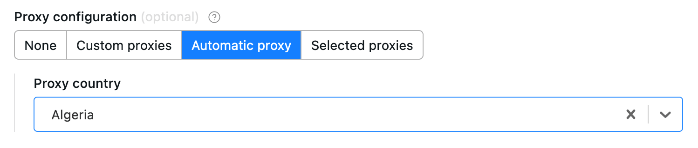
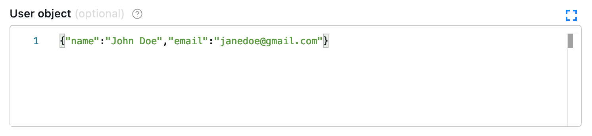
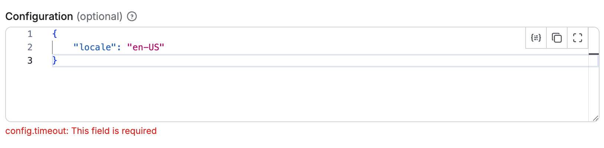
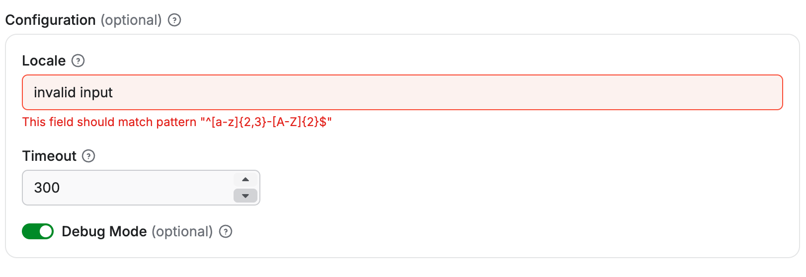

Object fields hold a nested value. The editor decides whether users see a proxy picker, a JSON editor, or one input per sub-property, and an optional sub-schema validates the sub-properties.

Example of proxy configuration:

```json
{
    "title": "Proxy configuration",
    "type": "object",
    "description": "Select proxies to be used by your crawler.",
    "prefill": { "useApifyProxy": true },
    "editor": "proxy"
}
```

Rendered input:



The object where the proxy configuration is stored has the following structure:

```json5
{
    // Indicates whether Apify Proxy was selected.
    "useApifyProxy": Boolean,

    // Array of Apify Proxy groups. Is missing or null if
    // Apify Proxy's automatic mode was selected
    // or if proxies are not used.
    "apifyProxyGroups": String[],

    // Array of custom proxy URLs.
    // Is missing or null if custom proxies were not used.
    "proxyUrls": String[],
}
```

Example of a black box object:

```json
{
    "title": "User object",
    "type": "object",
    "description": "Enter object representing user",
    "prefill": {
        "name": "John Doe",
        "email": "janedoe@gmail.com"
    },
    "editor": "json"
}
```

Rendered input:



Properties:

| Property               | Value                                                                                  | Required | Description                                                                                                                                                                                                                      |
|------------------------|----------------------------------------------------------------------------------------|----------|----------------------------------------------------------------------------------------------------------------------------------------------------------------------------------------------------------------------------------|
| `editor`               | One of <ul><li>`json`</li><li>`proxy`</li><li>`schemaBased`</li><li>`hidden`</li></ul> | Yes      | UI editor used for input.                                                                                                                                                                                                        |
| `maxProperties`        | Integer                                                                                | No       | Maximum number of properties <br/>the object can have.                                                                                                                                                                           |
| `minProperties`        | Integer                                                                                | No       | Minimum number of properties <br/>the object can have.                                                                                                                                                                           |
| `nullable`             | Boolean                                                                                | No       | Specifies whether null is <br/>an allowed value.                                                                                                                                                                                 |
| `isSecret`             | Boolean                                                                                | No       | Specifies whether the input field will be stored encrypted. Only available with `json` and `hidden` editors.                                                                                                                     |
| `properties`           | Object                                                                                 | No       | Defines the sub-schema properties for the object used for validation and UI rendering (`schemaBased` editor). See more info below.                                                                                               |
| `additionalProperties` | Boolean                                                                                | No       | Controls if sub-properties not listed in `properties` are allowed. Defaults to `true`. Set to `false` to make requests with extra properties fail.                                                                               |
| `required`             | String array                                                                           | No       | An array of sub-properties keys that are required. <br />Note: This applies only if the object field itself is present. If the object field is optional and not included in the input, its required subfields are not validated. |

## Object fields validation

Like root-level input schemas, you can define a schema for sub-properties of an object using the `properties` field.

Each sub-property within this sub-schema can define the same fields as those available at the root level of the input schema, except for the fields that apply only at the root level: `sectionCaption` and `sectionDescription`.

Validation is performed both in the UI and during Actor execution via the API. Sub-schema validation works independently of the editor selected for the parent object. It also respects the `additionalProperties` and `required` fields, giving you precise control over whether properties not defined in `properties` are permitted and which properties are mandatory.

:::note Recursive nesting

Object sub-properties can define their own sub-schemas recursively with no nesting depth limit.

:::

```json title="Example of an object property with sub-schema properties"
{
    "title": "Configuration",
    "type": "object",
    "description": "Advanced configuration options",
    "editor": "json",
    "properties": {
        "locale": {
            "title": "Locale",
            "type": "string",
            "description": "Locale identifier.",
            "pattern": "^[a-z]{2,3}-[A-Z]{2}$"
        },
        "timeout": {
            "title": "Timeout",
            "type": "integer",
            "description": "Request timeout in seconds",
            "minimum": 1,
            "maximum": 300
        },
        "debugMode": {
            "title": "Debug Mode",
            "type": "boolean",
            "description": "Enable verbose logging during scraping"
        }
    },
    "required": ["locale", "timeout"],
    "additionalProperties": false
}
```

Rendered input:


In this example, the object has validation rules for its properties:

- The `timeout` property must be an integer between 1 and 300
- The `locale` property must be a string matching the pattern `^[a-z]{2,3}-[A-Z]{2}$`
- The `debugMode` property is optional and can be either `true` or `false`
- The `timeout` and `locale` properties are required
- No additional properties beyond those defined are allowed

### Handling default and prefill values for object sub-properties

When defining object with sub-properties, it's possible to set `default` and `prefill` values in two ways:

1. _At the parent object level_: You can provide a complete object as the `default` or `prefill` value, which will set values for all sub-properties at once.
2. _At the individual sub-property level_: You can specify `default` or `prefill` values for each sub-property separately within the `properties` definition.

When both methods are used, the values defined at the parent object level take precedence over those defined at the sub-property level.
For example, in the input schema like this:

```json
{
    "title": "Configuration",
    "type": "object",
    "description": "Advanced configuration options",
    "editor": "schemaBased",
    "default": {
        "timeout": 60
    },
    "properties": {
        "locale": {
            "title": "Locale",
            "type": "string",
            "description": "Locale identifier.",
            "pattern": "^[a-z]{2,3}-[A-Z]{2}$",
            "editor": "textfield",
            "default": "en-US"
        },
        "timeout": {
            "title": "Timeout",
            "type": "integer",
            "description": "Request timeout in seconds",
            "minimum": 1,
            "maximum": 300,
            "editor": "number",
            "default": 120
        }
    }
}
```

The `timeout` sub-property will have a default value of `60` (from the parent object), while the `locale` sub-property will have a default value of `"en-US"` (from its own definition).

## Schema-based editor

Object with sub-schema defined can use the `schemaBased` editor, which provides a user-friendly interface for editing each property individually.
It renders all properties based on their type (and `editor` field), providing a user-friendly interface for complex objects.
This feature works for objects (and arrays of objects), enabling each property to have its own input field in the UI.

Objects with a defined sub-schema can use the `schemaBased` editor, which provides a user-friendly interface for editing each property individually.
It renders all properties based on their type (and optionally the `editor` field), making it ideal for visually managing complex object structures.
This editor supports both single objects and arrays of objects (see [Array](./array.md)), allowing each property to be represented with an appropriate input field in the UI.

```json title="Example of an object property with sub-schema properties using schemaBased editor"
{
    "title": "Configuration",
    "type": "object",
    "description": "Advanced configuration options",
    "editor": "schemaBased",
    "properties": {
        "locale": {
            "title": "Locale",
            "type": "string",
            "description": "Locale identifier.",
            "pattern": "^[a-z]{2,3}-[A-Z]{2}$",
            "editor": "textfield"
        },
        "timeout": {
            "title": "Timeout",
            "type": "integer",
            "description": "Request timeout in seconds",
            "minimum": 1,
            "maximum": 300,
            "editor": "number"
        },
        "debugMode": {
            "title": "Debug Mode",
            "type": "boolean",
            "description": "Enable verbose logging during scraping",
            "editor": "checkbox"
        }
    },
    "required": ["locale", "timeout"],
    "additionalProperties": false
}
```

Rendered input:


Each sub-property is rendered with its own input field according to its type and `editor` configuration:

- The `locale` property is rendered as a text field.
- The `timeout` property is rendered as a numeric input with validation limits.
- The `debugMode` property is rendered as a checkbox toggle.

### Limitations

The `schemaBased` editor supports only **top-level sub-properties** (level 1 nesting).
While deeper nested properties can still define sub-schemas for validation, they cannot use the `schemaBased` editor for rendering.
For example, if the Configuration object above included a property that was itself an object with its own sub-properties, those deeper levels would need to use a different editor, such as `json`.
