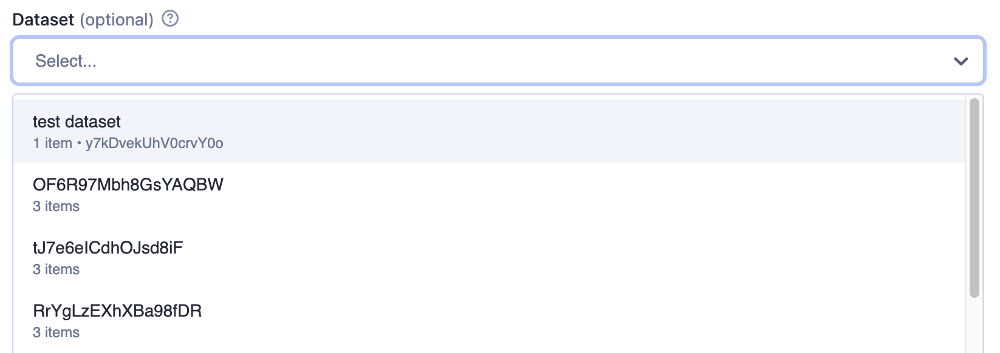
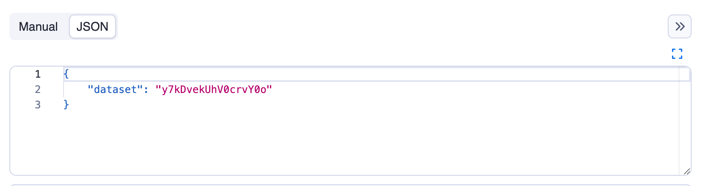
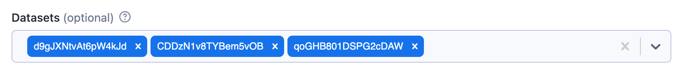

Resource type identifies what kind of Apify Platform object is referred to in the input field. For example, the Key-value store resource type can be referred to using a string ID.

Supported resource types are storage resources (dataset, key-value store, request queue) and [MCP connectors](/integrations/mcp-connectors), which let an Actor call third-party MCP servers using credentials the user has authorized in their account.

For Actor developers, the resource input value is a string representing either the resource ID or (unique) name.
The type of the property is either `string` or `array`. In case of `array` (for multiple resources) the return value is an array of IDs or names.
In the user interface, a picker (`resourcePicker` editor) is provided for easy selection, where users can search and choose from their own resources or those they have access to.

Example of a Dataset input:

```json
{
    "title": "Dataset",
    "type": "string",
    "description": "Select a dataset",
    "resourceType": "dataset"
}
```

Rendered input:



The returned value is resource reference, in this example it's the dataset ID as can be seen in the JSON tab:



Example of multiple datasets input:

```json
{
    "title": "Datasets",
    "type": "array",
    "description": "Select multiple datasets",
    "resourceType": "dataset",
    "resourcePermissions": ["READ"]
}
```

Rendered input:



## Single value properties

| Property | Value | Required | Description |
| --- | --- | --- | --- |
| `type` | `string` | Yes | Specifies the type of input - `string` for single value. |
| `editor` | One of <ul><li>`resourcePicker`</li><li>`textfield`</li><li>`hidden`</li></ul> | No | Visual editor used for <br/>the input field. Defaults to `resourcePicker`. |
| `resourceType` | One of <ul><li>`dataset`</li><li>`keyValueStore`</li><li>`requestQueue`</li><li>`mcpConnector`</li></ul> | Yes | Type of Apify Platform resource. Use `mcpConnector` to accept an [MCP connector](/integrations/mcp-connectors) as input. |
| `resourcePermissions` | Array of strings; allowed values: <ul><li>`READ`</li><li>`WRITE`</li></ul> | Yes for storage resources; not used for `mcpConnector` | Permissions requested for the referenced resource. Use [\"READ\"] for read-only access, or [\"READ\", \"WRITE\"] to allow writes. |
| `pattern` | String | No | Regular expression that will be used to validate the input. If validation fails, the Actor will not run. |
| `minLength` | Integer | No | Minimum length of the string. |
| `maxLength` | Integer | No | Maximum length of the string. |

## Multiple values properties

| Property | Value | Required | Description |
| --- | --- | --- | --- |
| `type` | `array` | Yes | Specifies the type of input - `array` for multiple values. |
| `editor` | One of <ul><li>`resourcePicker`</li><li>`hidden`</li></ul> | No | Visual editor used for <br/>the input field. Defaults to `resourcePicker`. |
| `resourceType` | One of <ul><li>`dataset`</li><li>`keyValueStore`</li><li>`requestQueue`</li><li>`mcpConnector`</li></ul> | Yes | Type of Apify Platform resource. Use `mcpConnector` to accept [MCP connectors](/integrations/mcp-connectors) as input. |
| `resourcePermissions` | Array of strings; allowed values: <ul><li>`READ`</li><li>`WRITE`</li></ul> | Yes for storage resources; not used for `mcpConnector` | Permissions requested for the referenced resources. Use [\"READ\"] for read-only access, or [\"READ\", \"WRITE\"] to allow writes. Applies to each selected resource. |
| `minItems` | Integer | No | Minimum number of items the array can contain. |
| `maxItems` | Integer | No | Maximum number of items the array can contain. |

## Resource permissions

If your Actor runs with limited permissions, it must declare what access it needs to resources supplied via input. The `resourcePermissions` field defines which operations your Actor can perform on user-selected storages. This field is evaluated at run start and expands the Actor's [limited permissions](../../../permissions/index.md) scope to access resources sent via input.

- `["READ"]` - The Actor can read from the referenced resources.
- `["READ", "WRITE"]` -  The Actor can read from and write to the referenced resources.

:::note Runtime behavior

This setting defines runtime access only and doesn't change field visibility or whether the field is required in the UI. For array fields (`type: array`), the same permissions apply to each selected resource. Your Actor's run will fail with an insufficient-permissions error if it attempts an operation without the required permission, such as writing with read-only access. Users can see the required permissions in the [input field's tooltip](../../../../running/permissions.md#view-permission-levels-in-apify-console-and-apify-store).

:::

## MCP connector resource type

When `resourceType` is `mcpConnector`, the input field accepts one or more [MCP connectors](/integrations/mcp-connectors) the user has authorized in their account. The Actor receives the connector ID (or an array of IDs) as the input value and connects to the upstream MCP server through the Apify MCP Proxy at runtime.

The `mcpConnector` resource type does not use `resourcePermissions`. Instead, eligibility and per-tool access are declared through a required `mcpServers` field, which lists the upstream MCP server URLs and tool constraints the Actor accepts:

```json
{
    "slackConnector": {
        "title": "Slack connector",
        "description": "Read-only access to your Slack workspace",
        "type": "string",
        "resourceType": "mcpConnector",
        "mcpServers": [
            {
                "url": "https://mcp.slack.com/mcp",
                "tools": {
                    "required": ["list_*", "get_*", "read_*"],
                    "readOnly": true
                }
            }
        ]
    }
}
```

The same declaration acts as both eligibility filter (the input picker only offers compatible connectors) and runtime ceiling (the proxy rejects tool calls outside the declared set). For the full `mcpServers` schema, behavioral hints, and code samples, see [Build Actors with MCP connectors](/integrations/mcp-connectors/use-in-actors).
