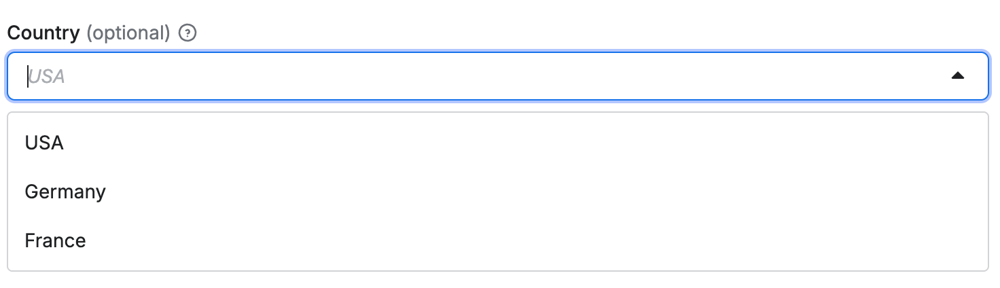
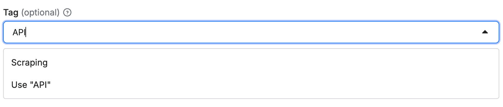
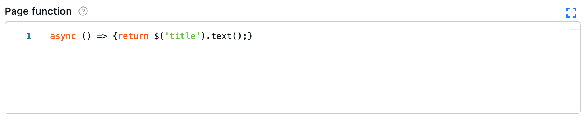
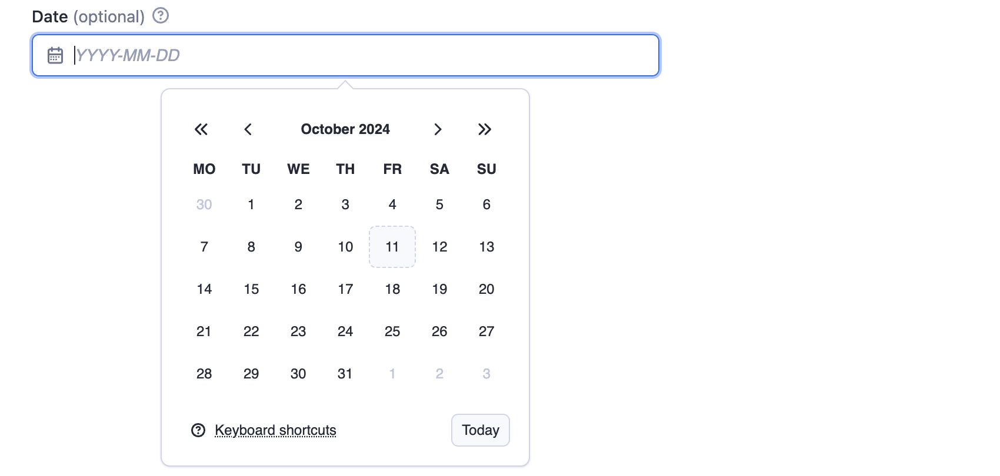
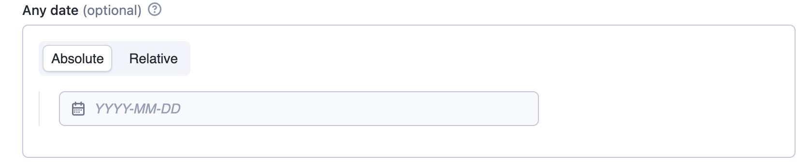
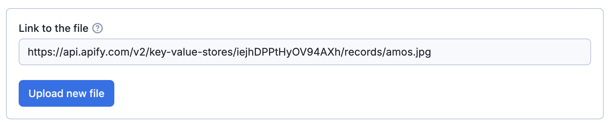
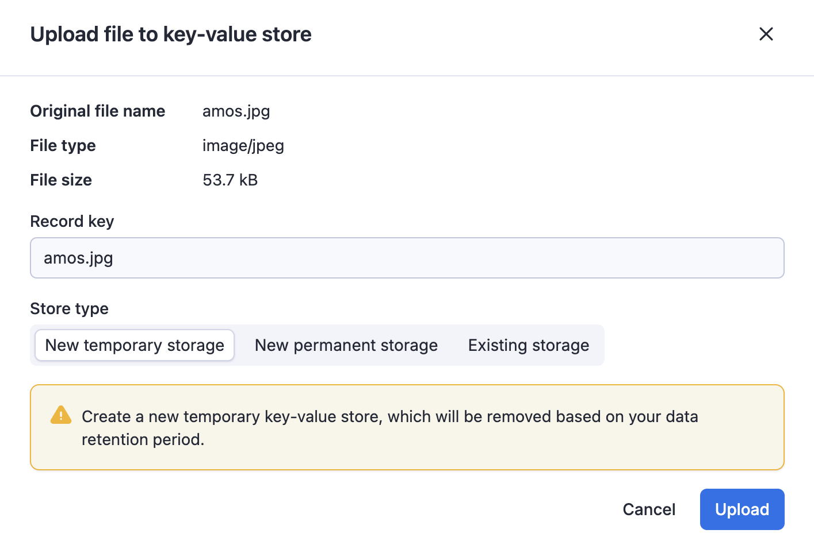

String is the most common input field type, and provide a number of editors and validations properties:

| Property              | Value                                                                                                                                            | Required                         | Description                                                                                                                                                                                                                                                                                                                                                                                                                                                                                                                                                                                                                                                                                                                                                                                                                                                                                                                                                                                              |
|-----------------------|--------------------------------------------------------------------------------------------------------------------------------------------------|----------------------------------|----------------------------------------------------------------------------------------------------------------------------------------------------------------------------------------------------------------------------------------------------------------------------------------------------------------------------------------------------------------------------------------------------------------------------------------------------------------------------------------------------------------------------------------------------------------------------------------------------------------------------------------------------------------------------------------------------------------------------------------------------------------------------------------------------------------------------------------------------------------------------------------------------------------------------------------------------------------------------------------------------------|
| `editor`              | One of:<br/>- `textfield`<br/>- `textarea`<br/>- `javascript`<br/>- `python`<br/>- `select`<br/>- `datepicker`<br/>- `fileupload`<br/>- `hidden` | Yes                              | Visual editor used for the input field.                                                                                                                                                                                                                                                                                                                                                                                                                                                                                                                                                                                                                                                                                                                                                                                                                                                                                                                                                                  |
| `pattern`             | String                                                                                                                                           | No                               | Regular expression that will be used to validate the input. If validation fails, the Actor will not run.                                                                                                                                                                                                                                                                                                                                                                                                                                                                                                                                                                                                                                                                                                                                                                                                                                                                                                 |
| `minLength`           | Integer                                                                                                                                          | No                               | Minimum length of the string.                                                                                                                                                                                                                                                                                                                                                                                                                                                                                                                                                                                                                                                                                                                                                                                                                                                                                                                                                                            |
| `maxLength`           | Integer                                                                                                                                          | No                               | Maximum length of the string.                                                                                                                                                                                                                                                                                                                                                                                                                                                                                                                                                                                                                                                                                                                                                                                                                                                                                                                                                                            |
| `enum`                | [String]                                                                                                                                         | Required if `editor` is `select` | Using this field, you can limit values to the given array of strings. Input will be displayed as select box. Values are strictly validated against this list.                                                                                                                                                                                                                                                                                                                                                                                                                                                                                                                                                                                                                                                                                                                                                                                                                                            |
| `enumSuggestedValues` | [String]                                                                                                                                         | No                               | Similar to `enum`, but only suggests values in the UI without enforcing validation. Users can select from the dropdown or enter custom value.<br/> Works only with the `select` editor.                                                                                                                                                                                                                                                                                                                                                                                                                                                                                                                                                                                                                                                                                                                                                                                                                  |
| `enumTitles`          | [String]                                                                                                                                         | No                               | Displayed titles for the `enum` or `enumSuggestedValues` properties.                                                                                                                                                                                                                                                                                                                                                                                                                                                                                                                                                                                                                                                                                                                                                                                                                                                                                                                                     |
| `nullable`            | Boolean                                                                                                                                          | No                               | Specifies whether `null` is an allowed value.                                                                                                                                                                                                                                                                                                                                                                                                                                                                                                                                                                                                                                                                                                                                                                                                                                                                                                                                                            |
| `isSecret`            | Boolean                                                                                                                                          | No                               | Specifies whether the input field will be stored encrypted. Only available with `textfield`, `textarea` and `hidden` editors.                                                                                                                                                                                                                                                                                                                                                                                                                                                                                                                                                                                                                                                                                                                                                                                                                                                                            |
| `dateType`            | One of <ul><li>`absolute`</li><li>`relative`</li><li>`absoluteOrRelative`</li></ul>                                                              | No                               | This property, which is only available with `datepicker` editor, specifies what date format should visual editor accept (The JSON editor accepts any string without validation.).<br/><br/><ul><li>`absolute` value enables date input in `YYYY-MM-DD` format. To parse returned string regex like this can be used: `^(\d{4})-(0[1-9]\|1[0-2])-(0[1-9]\|[12]\d\|3[01])$`.</li><br/><li>`relative` value enables relative date input in <br/>`{number} {unit}` format. <br/>Supported units are: days, weeks, months, years.<br/><br/>The input is passed to the Actor as plain text (e.g., "3 weeks"). To parse it, regex like this can be used: `^(\d+)\s*(day\|week\|month\|year)s?$`.</li><br/><li>`absoluteOrRelative` value enables both absolute and relative formats and user can switch between them. It's up to Actor author to parse a determine actual used format - regexes above can be used to check whether the returned string match one of them.</li></ul><br/>Defaults to `absolute`. |

:::note Regex escape

When using escape characters `\` for the regular expression in the `pattern` field, be sure to escape them to avoid invalid JSON issues. For example, the regular expression `https:\/\/(www\.)?apify\.com\/.+` would become `https:\\/\\/(www\\.)?apify\\.com\\/.+`.

:::

## Select editor for strings

The `select` editor for strings allows users to choose a value from a dropdown list.
You can either only allow users to select from a set of predefined values, or allow them to specify custom values in addition to suggested values.

### Select from predefined values

When you need to restrict input to a specific set of values, use the `enum` property:

```json
{
    "title": "Country",
    "type": "string",
    "description": "Select your country",
    "editor": "select",
    "default": "us",
    "enum": ["us", "de", "fr"],
    "enumTitles": ["USA", "Germany", "France"]
}
```

The `select` editor is rendered as drop-down in user interface:



### Select with custom input

When you want to suggest values but still allow custom input, use the `enumSuggestedValues` property:

```json
{
    "title": "Tag",
    "type": "string",
    "description": "Select or enter a custom tag",
    "editor": "select",
    "default": "web",
    "enumSuggestedValues": ["web", "scraping", "automation"],
    "enumTitles": ["Web", "Scraping", "Automation"]
}
```

This creates a select dropdown with suggested values, but users can also enter custom values:



## Code editor

If the input string is code, you can use either `javascript` or `python` editor
for syntax highlighting.

For example:

```json
{
    "title": "Page function",
    "type": "string",
    "description": "Function executed for each request",
    "editor": "javascript",
    "prefill": "async () => { return $('title').text(); }"
}
```

Rendered input:



## Date picker

Example of date selection using absolute and relative `datepicker` editor:

```json
{
    "absoluteDate": {
        "title": "Date",
        "type": "string",
        "description": "Select absolute date in format YYYY-MM-DD",
        "editor": "datepicker",
        "pattern": "^(\\d{4})-(0[1-9]|1[0-2])-(0[1-9]|[12]\\d|3[01])$"
    },
    "relativeDate": {
        "title": "Relative date",
        "type": "string",
        "description": "Select relative date in format: {number} {unit}",
        "editor": "datepicker",
        "dateType": "relative",
        "pattern": "^(\\d+)\\s*(day|week|month|year)s?$"
    },
    "anyDate": {
        "title": "Any date",
        "type": "string",
        "description": "Select date in format YYYY-MM-DD or {number} {unit}",
        "editor": "datepicker",
        "dateType": "absoluteOrRelative",
        "pattern": "^(\\d{4})-(0[1-9]|1[0-2])-(0[1-9]|[12]\\d|3[01])$|^(\\d+)\\s*(day|week|month|year)s?$"
    }
}
```

The `absoluteDate` property renders a date picker that allows selection of a specific date and returns string value in `YYYY-MM-DD` format. Validation is ensured thanks to `pattern` field. In this case the `dateType` property is omitted, as it defaults to `"absolute"`.



The `relativeDate` property renders an input field that enables the user to choose the relative date and returns the value in `{number} {unit}` format, for example `"2 days"`. The `dateType` parameter is set to `"relative"` to restrict input to relative dates only.


The `anyDate` property renders a date picker that accepts both absolute and relative dates. The Actor author is responsible for parsing and interpreting the selected date format.



## Advanced date and time handling

While the `datepicker` editor doesn't support setting time values visually, you can allow users to handle more complex datetime formats and pass them via JSON. The following regex allows users to optionally extend the date with full ISO datetime format or pass `hours` and `minutes` as a relative date:

`"pattern": "^(\\d{4})-(0[1-9]|1[0-2])-(0[1-9]|[12]\\d|3[01])(T[0-2]\\d:[0-5]\\d(:[0-5]\\d)?(\\.\\d+)?Z?)?$|^(\\d+)\\s*(minute|hour|day|week|month|year)s?$"`

When implementing time-based fields, make sure to explain to your users through the description that the time values should be provided in UTC. This helps prevent timezone-related issues.

## File upload

The `fileupload` editor enables users to specify a file as input. The input is passed to the Actor as a string. It is the Actor author's responsibility to interpret this string, including validating its existence and format.

The editor makes it easier to users to upload the file to a key-value store of their choice.



The user provides either a URL or uploads the file to a key-value store (existing or new).


