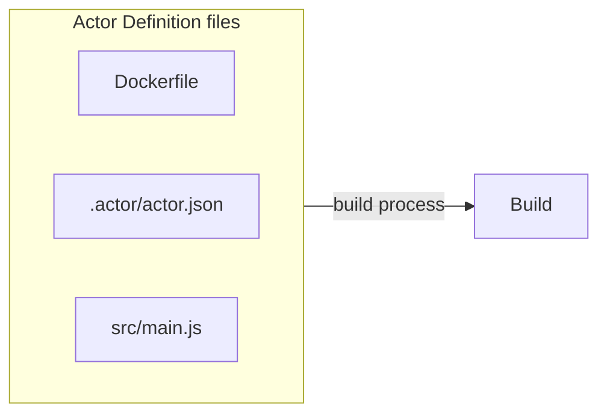
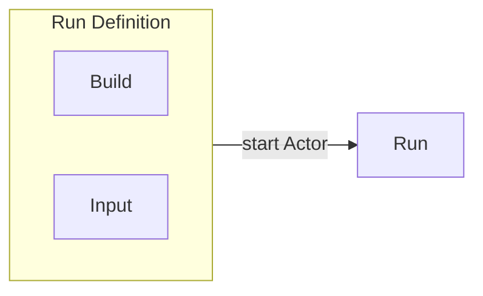

import ActorJobLifecycle from '@site/sources/_partials/_actor-job-lifecycle.mdx';

Actor **builds** and **runs** are fundamental concepts within the Apify platform. Understanding them is crucial for effective use of the platform.

## Build an Actor

When you start the build process for your Actor, you create a _build_. A build is a Docker image containing your source code and the required dependencies needed to run the Actor:

## Run an Actor

To create a _run_, you take your _build_ and start it with some input:

<ActorJobLifecycle />
