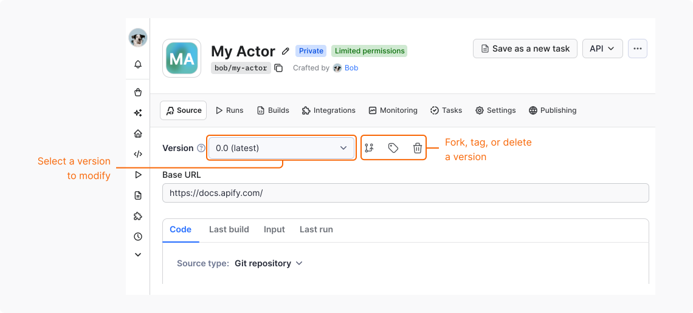

Once you [publish your Actor](/actors/publishing), users can build integrations on it. As a result, every build you release can affect them. Versioning lets you ship improvements without breaking the integrations that depend on your Actor.

## When to skip versioning

A new Actor has a single version with the `latest` tag that points to the newest successful build. Users who run your Actor without choosing a specific build always run the build tagged `latest`.

You can rely on that setup and skip versioning in the following cases:

- Your Actor isn't likely to change.
- Your Actor's input and output are simple and unlikely to change.
- Users run your Actor manually and don't use it in their integrations.

In all other cases, Apify recommends that you version your Actor. Users can then rely on a version that doesn't change unexpectedly, and versioning shows them that you maintain your Actor.

## Create a version

To version your Actor, stop using the `latest` tag. Create a separate version for each release line and give each version its own build tag. Each version has its own source code, environment variables, and build tag, so changing one version doesn't affect the others.

An Actor can have up to 10 versions.

### In Apify Console

In Apify Console, you create a version by forking an existing one:

1. Log in to [Apify Console](https://console.apify.com).
1. In the left-side panel, go to **Development** > **My Actors**.
1. From the table, select the Actor to update.
1. In the **Source** tab, choose the version from the dropdown, then select **Fork**.
1. In the **Fork Actor version** dialog:
    - Enter the new version number. Use the `major.minor` format, for example `1.0`.
    - _(Optional)_ To copy non-secret environment variables from the forked version, select the checkbox.
1. Select **Fork**.

Apify Console creates the version. The next step is to give the new version its own build tag:

1. In the **Source** tab, select the new version from the dropdown, then select **Tag**.
1. In the **Tag Actor version** dialog, enter the tag name.
    - Build tags must be 1-30 characters long and contain only letters, digits, and hyphens.
    - They must start and end with a letter or digit, for example `version-1-0`.
1. Save your changes.

You can now make changes to the new version's source code and build the Actor. When the build succeeds, the new tag points to it.



### With Apify CLI

To create a version with Apify CLI, push your code with a version number that doesn't exist yet. The CLI creates the version, uploads your local code as its source, and starts a build:

```bash
apify push --version=0.1 --build-tag=version-1-0
```

For the new version, the CLI sets only the environment variables defined in `environmentVariables` in `.actor/actor.json`.

To use the new version for every push, update `version` and `buildTag` in [`.actor/actor.json`](/actors/development/actor-definition/actor-json):

```json
{
    "actorSpecification": 1,
    "name": "my-actor",
    "version": "1.0",
    "buildTag": "version-1-0"
}
```

## Set the default build

After you release a new version, point the default build to that version's tag. Users who don't choose a specific build always run the Actor's default build.

### In Apify Console

To set the default build in Apify Console:

1. Log in to [Apify Console](https://console.apify.com).
1. In the left-side panel, go to **Development** > **My Actors**.
1. From the table, select the Actor to update.
1. Go to the **Settings** tab.
1. In the **Options** section, set **Build** to the new tag.

### With the Apify API

To set the default build with the Apify API, use the [Update Actor](/api/v2/actor-put) endpoint and set the tag in `defaultRunOptions`:

```json
{
    "defaultRunOptions": {
        "build": "version-1-0"
    }
}
```

## Release non-breaking changes

A non-breaking change might be a bug fix, a performance improvement, or a library update that doesn't modify your Actor's behavior.

To release a non-breaking change, build the Actor under the same version. The build number increments automatically, for example from `0.1.2` to `0.1.3`. Test your changes before you build, because when the build succeeds, the tag is applied immediately.

Users who pin the tag or run the default build for the version get the changes on their next run.

## Release breaking changes

Breaking changes might cause existing integrations to stop working. Such changes include:

- Removing or renaming an input field
- Adding a required input field
- Changing the structure of the output
- Changing what the Actor does with the same input

Release a breaking change as a new version with its own tag. Users who pin the tag of the previous version keep running it. Users who run the default build move to the new version.

## Start versioning an already published Actor

To start versioning an already published Actor, follow the same steps as for a new Actor: create a version, build it, and set its tag as the default build.

If you deploy with the Apify CLI, also update `buildTag` and `version` in [`.actor/actor.json`](/actors/development/actor-definition/actor-json).

The `latest` tag stays on the last build you made before introducing versioning. Users who run that tag explicitly, for example in API calls, tasks, or integrations, stay on that build and don't get updates. Inform your users about the change.

## Keep a changelog

A changelog tells users what changed in each version and which build tag to pin. Users can view the changelog on your Actor's **Changelog** tab in Apify Store and Console.

For each release, add an entry with the following information:

- The version and its tag
- The release date
- A list of changes
