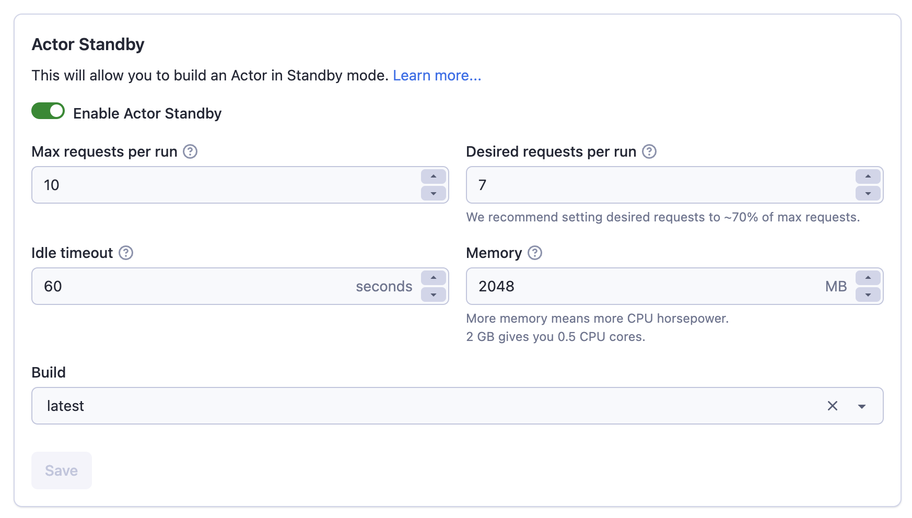

import Tabs from '@theme/Tabs';
import TabItem from '@theme/TabItem';

While a traditional Actor runs a single job and stops, an Actor in Standby mode runs a persistent HTTP server and responds to incoming requests in real time. For the user-facing overview of Standby mode, including endpoints, authentication, scaling, configuration, and billing, see [Actor Standby mode](../../running/actor_standby.md).

## Enable Standby mode

You can enable Standby mode from a template, in Apify Console, or in the Actor's source code.

### Start from a template

The best way to start developing Standby Actors is to use the predefined templates in [Apify Console](https://console.apify.com/actors/templates) or in the [Apify CLI](https://docs.apify.com/cli/) via `apify create`. The templates contain minimal code to get you up to speed for development in JavaScript, TypeScript, or Python. Standby mode will automatically be enabled with default settings.

### Enable Standby in Apify Console

To enable or tweak Standby mode for an existing Actor, head to the **Settings** tab of your Actor, where the Actor Standby settings are located.



If you want to enforce the same Standby configuration for all users of your Actor, enable **Prevent users from overriding standby parameters** in the same settings. Users then can't override the configuration by creating a task.

### Enable Standby in the source code

You can also enable Standby mode by setting the [`usesStandbyMode`](../actor_definition/actor_json.md) property to `true` in the `.actor/actor.json` file. When you push the Actor with the [Apify CLI](https://docs.apify.com/cli/), the setting syncs to the platform.

## Run an HTTP server

Actors using Standby mode must run an HTTP server listening on a specific port. The platform proxies user requests to that server. The requests can use any of the existing [HTTP request methods](https://developer.mozilla.org/en-US/docs/Web/HTTP/Methods), such as GET, POST, PUT, or DELETE, and pass input via the [query string](https://en.wikipedia.org/wiki/Query_string) or the [request body](https://developer.mozilla.org/en-US/docs/Web/HTTP/Messages#body).

### Get the port

The server must listen on the port defined by the `ACTOR_WEB_SERVER_PORT` environment variable. If you use the Apify SDK, read the port from the Actor configuration instead: the option is named `containerPort` in JavaScript and `web_server_port` in Python.

If your server must listen on a specific port that you can't change in code, define `ACTOR_WEB_SERVER_PORT` as a custom [environment variable](./environment_variables.md) of the Actor, with that port as the value. The platform then proxies the requests to your port.

### Example server

See the example below with a simple Actor using Standby mode.

<Tabs groupId="main">
<TabItem value="JavaScript" label="JavaScript">

```javascript
import http from 'http';
import { Actor } from 'apify';

await Actor.init();

const server = http.createServer((req, res) => {
    res.writeHead(200, { 'Content-Type': 'text/plain' });
    res.end('Hello from Actor Standby!\n');
});

server.listen(Actor.config.get('containerPort'));
```

</TabItem>
<TabItem value="Python" label="Python">

```python
from http.server import HTTPServer, SimpleHTTPRequestHandler
from apify import Actor

class GetHandler(SimpleHTTPRequestHandler):
    def do_GET(self):
        self.send_response(200)
        self.end_headers()
        self.wfile.write(b'Hello from Actor Standby!')

async def main() -> None:
    async with Actor:
        with HTTPServer(('', Actor.configuration.web_server_port), GetHandler) as http_server:
            http_server.serve_forever()
```

</TabItem>
</Tabs>

## Describe your endpoints

Describe your Actor's endpoints, their parameters, and responses with a [web server schema](../actor_definition/web_server_schema/index.md) defined in the [`.actor/actor.json`](../actor_definition/actor_json.md) file. Based on that definition, Apify Console renders an interactive **Endpoints** tab on the Actor's detail page, where users can browse the endpoints and send requests directly from the browser. Describe the endpoints in your Actor's [README](../../publishing/publish/actor-readme.mdx) as well, because that's what users see in Apify Store before they ever open the Actor's detail page.

## Run lifecycle

The platform starts and stops Standby runs automatically based on the incoming request load. It stops a run that receives no requests within the configured idle timeout and starts a new run when requests arrive again. Don't keep data only in the run's memory: persist anything you need to a [dataset or key-value store](../../../storage/index.md). See [how Standby scaling works](../../running/actor_standby.md#automatic-scaling), [how to customize the Standby configuration](../../running/actor_standby.md#standby-configuration), and [the timeouts and rate limits](../../running/actor_standby.md#limits-and-scaling) that apply to incoming requests.

### Readiness probe

Before Actor Standby runs are ready to serve requests, the Apify platform checks the web server's readiness using a readiness probe.
The platform sends a GET request to the path `/` with a header `x-apify-container-server-readiness-probe`. If the header is present in the request, you can perform an early return with a simple response to prevent wasting resources.

:::caution Return a response

You must return a response; otherwise, the Actor run will never be marked as ready and won't process requests.

:::

See the example code below that distinguishes between "normal" and "readiness probe" requests.

<Tabs groupId="main">
<TabItem value="JavaScript" label="JavaScript">

```javascript
import http from 'http';
import { Actor } from 'apify';

await Actor.init();

const server = http.createServer((req, res) => {
    res.writeHead(200, { 'Content-Type': 'text/plain' });
    if (req.headers['x-apify-container-server-readiness-probe']) {
        console.log('Readiness probe');
        res.end('Hello, readiness probe!\n');
    } else {
        console.log('Normal request');
        res.end('Hello from Actor Standby!\n');
    }
});

server.listen(Actor.config.get('containerPort'));
```

</TabItem>
<TabItem value="Python" label="Python">

```python
from http.server import HTTPServer, SimpleHTTPRequestHandler
from apify import Actor

class GetHandler(SimpleHTTPRequestHandler):
    def do_GET(self) -> None:
        self.send_response(200)
        self.end_headers()
        if self.headers['x-apify-container-server-readiness-probe']:
            print('Readiness probe')
            self.wfile.write(b'Hello, readiness probe!')
        else:
            print('Normal request')
            self.wfile.write(b'Hello, normal request!')

async def main() -> None:
    async with Actor:
        with HTTPServer(('', Actor.configuration.web_server_port), GetHandler) as http_server:
            http_server.serve_forever()
```

</TabItem>
</Tabs>

### Run termination

A run ends when its process exits, when it migrates to another machine, or when it stays idle for longer than the idle timeout. Apart from the [readiness probe](#readiness-probe), the platform doesn't check your server's health while the run is alive. A server that stays up but stops responding keeps receiving requests, so on an unrecoverable error, exit the process instead of swallowing the error.

## Detect the run mode

Actors that support Actor Standby can still be started in standard mode, for example from Apify Console or via the API.
To find out which mode the Actor was started in, read the `metaOrigin` option in `Actor.config`, or the `APIFY_META_ORIGIN` environment variable in case you're not using the Apify SDK.
If it equals `STANDBY`, the Actor was started in Standby mode; otherwise it was started in standard mode.

<Tabs groupId="main">
<TabItem value="JavaScript" label="JavaScript">

```javascript
import { Actor } from 'apify';

await Actor.init();

if (Actor.config.get('metaOrigin') === 'STANDBY') {
    // Start your Standby server here
} else {
    // Perform the standard Actor operations here
}
```

</TabItem>
<TabItem value="Python" label="Python">

```python
from apify import Actor

async def main() -> None:
    async with Actor:
        if Actor.configuration.meta_origin == 'STANDBY':
            ...  # Start your Standby server here
        else:
            ...  # Perform the standard Actor operations here
```

</TabItem>
</Tabs>

## Standby URL

Each Standby Actor has a URL that stays the same for all of its runs. The URL is exposed as the `ACTOR_STANDBY_URL` environment variable and as the `standbyUrl` option in `Actor.config`.

Unlike the Standby URL, the [container web server](./container_web_server.md) URL changes with every run. For the URL formats and where users find them, see [Standby URLs](../../running/actor_standby.md#standby-urls).

Requests to the Standby URL require an Apify API token; see [how to authenticate requests](../../running/actor_standby.md#authenticate-requests). If your Actor exposes an MCP server, define the endpoint path with the [`webServerMcpPath`](../actor_definition/actor_json.md) property; see [Use Standby Actors as MCP servers](../../running/actor_standby.md#use-standby-actors-as-mcp-servers).

## Monetize Standby Actors

You can monetize Standby Actors just like any other Actor. For best results with Standby workflows, use the [pay-per-event pricing model](/actors/monetize/pay-per-event). In this model, users cover both the platform usage costs of their runs and the event costs.
