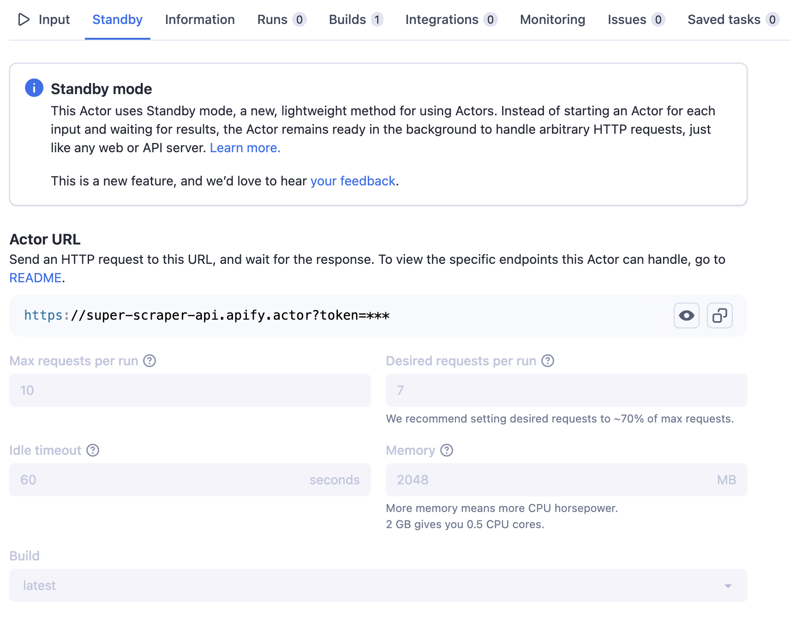

A traditional Actor runs a single job and then stops. That suits batch jobs, such as a large data extraction or processing task. Some applications can't wait for an Actor to start. In Standby mode, the Actor stays ready in the background and serves incoming HTTP requests in real time, like a web server or an API server.

To build your own Standby Actor, see [Develop Actors in Standby mode](../development/programming_interface/actor_standby.md).

## Check whether an Actor supports Standby mode

If an Actor has Standby mode enabled, its detail page shows the **Endpoints** tab. The tab contains the hostname of the Actor's server, and the Actor README describes the endpoints, the parameters they accept, and what they return.
If the Actor defines a [web server schema](../development/actor_definition/web_server_schema/index.md), the tab also shows an interactive list of its endpoints, where you can send requests directly from the browser.

You don't need to start the Actor. Send a request to that hostname and endpoint, and you get the results.



## Standby URLs

The Standby URL typically combines the Actor owner's username and the Actor name, for example:

```text
https://jane-doe--my-actor.apify.actor
```

The Actor also responds on a URL built from its ID, which keeps working if the Actor or its owner is renamed:

```text
https://92c4oi4fpzy7rprlf.apify.actor
```

The Standby URL stays the same for all runs of the Actor, so you can share it publicly or hardcode it in applications that call the Actor. Copy the URL from the **Endpoints** tab instead of building it from the username and Actor name, because some Actors use a different hostname format, like `rag-web-browser.apify.actor` in the examples below.

## Send requests to the Actor

If you use an Actor built by someone else, its **Readme** tab describes how to pass the input.

Actors in Standby mode behave as standard HTTP servers. Use any [HTTP request method](https://developer.mozilla.org/en-US/docs/Web/HTTP/Methods), such as GET, POST, PUT, or DELETE, and pass the input in the [query string](https://en.wikipedia.org/wiki/Query_string) or the [request body](https://developer.mozilla.org/en-US/docs/Web/HTTP/Messages#body).

## Authenticate requests

Authenticate Standby requests the same way as [requests to the Apify API](../../integrations/programming/api.md). Provide your [API token](../../integrations/programming/api.md#api-token) in one of two ways:

1. _Recommended_: Include the token in the `Authorization` header as `Bearer <token>`. This keeps the token out of server logs.

    ```bash
    curl -H "Authorization: Bearer my_apify_token" \
      https://rag-web-browser.apify.actor/search?query=apify
    ```

1. Append the token to the request URL as the `token` query parameter. Use this when you can't modify the request headers.

    ```text
    https://rag-web-browser.apify.actor/search?query=apify&token=my_apify_token
    ```

The platform removes the token from the request before forwarding it, so the token doesn't reach the Actor's code. If the Actor reads the `Authorization` header for its own authentication, send your Apify token in the `X-Apify-Authorization` header instead.

If you're developing a Standby Actor, use the token from the `APIFY_TOKEN` [environment variable](../development/programming_interface/environment_variables.md#system-environment-variables) to call the Apify API, as in any other Actor.

To let third-party services call your Actor without access to your entire account, send Standby requests with [scoped tokens](/integrations/api#limited-permissions).

:::caution Restricted access is not supported

Standby mode doesn't support [restricting what an Actor can access](/integrations/api#restricted-access-restrict-what-actors-can-access-using-the-scope-of-this-actor) with a scoped token.

:::

## Run the Actor in normal mode

You can still modify the input and select **Start** to run the Actor in normal mode. The platform always allows it, but the Actor might not support it. The run might fail or return empty results. Check the Actor README for what the Actor supports.

## Limits and scaling

The platform scales Standby runs automatically and applies timeouts and rate limits to the incoming requests.

### Automatic scaling

The platform scales the Actor to match the incoming requests. It starts new Actor runs, which appear in the Actor **Runs** tab with the origin set to Standby.

The runs that serve your requests aren't shared with other users, even when you use the Actor-level hostname with the default configuration.

The platform checks a run's readiness once, before the run starts serving requests, and performs no health checks after that.

:::caution Unresponsive servers aren't detected

If an Actor's server stays up but stops responding, the platform doesn't detect the failure, and requests keep going to that run. To learn how to handle this in your own Actors, see [Run lifecycle](../development/programming_interface/actor_standby.md#run-lifecycle).

:::

### Request timeouts

A request to a Standby Actor must receive its first response within _5 minutes_. This is the overall timeout for the request.

Within this window, the platform first selects an Actor run to handle the request, which can take up to _2 minutes_, for example when a new run needs to start. If no run becomes available within that time, the request fails with a `429` error.

### Rate limits

The platform rate-limits incoming requests to Standby Actors per user account. The limit is the same on all standard subscription plans, and custom plans can raise it. Responses include the current limit in the `X-RateLimit-Limit` header. When you exceed the limit, the platform responds with a `429` error.

## Standby configuration

The Standby configuration has these properties:

| Property | Description |
| --- | --- |
| Max requests per run | The maximum number of concurrent HTTP requests a single Standby Actor run can accept. When a request would exceed this limit, the platform starts a new run to handle it, which can take a few seconds. |
| Desired requests per run | The number of concurrent HTTP requests a single Standby Actor run is configured to handle. When requests exceed this number, the platform starts a new run ahead of time to handle the additional requests. |
| Memory (MB) | The amount of memory (RAM) allocated for the Actor in Standby mode, in megabytes. More memory usually lets the Actor handle more requests in parallel, but it also consumes more compute units and costs more. |
| Idle timeout (seconds) | If a run receives no HTTP requests within this time, the platform stops it. The next request might then need a new run, which can take a few seconds to start. A higher idle timeout improves responsiveness but costs more, because the run stays active longer. |
| Build | The Actor build that Standby runs use: a build tag (for example `latest`) or a build number (for example `0.1.2`). |

You can see the current values in the **Endpoints** tab of the Actor detail page. If you own the Actor, you can change its default Standby configuration in the **Settings** tab.

### Override the configuration with a task

If you use an Actor built by someone else, the Actor-level hostname always uses the developer's default configuration. To override it:

1. In [Apify Console](https://console.apify.com), create a new task from the Actor.
1. Open the **Endpoints** tab of the created task.
1. Modify the configuration as needed.
1. In your application, use the task's hostname instead of the Actor's.

:::note Developers can lock the configuration

The Actor's developer can lock the Standby configuration. In that case, the task-level settings have no effect.

:::

## Billing

The platform bills Standby runs like normal runs, but the costs can surprise you. A Standby run consumes resources in the background even when no requests arrive, until the idle timeout stops it.

For Actors monetized with the [pay-per-event pricing model](/actors/monetize/pay-per-event), you pay the platform usage costs of the Standby runs in addition to the event charges.

## Use Standby Actors as MCP servers

If the Actor exposes a [Model Context Protocol (MCP)](../../agents/mcp.md) server, its MCP endpoint is the Standby URL followed by the path defined in the Actor's [`webServerMcpPath`](../development/actor_definition/actor_json.md) property. Authenticate requests to the MCP endpoint the same way as any other Standby request.
