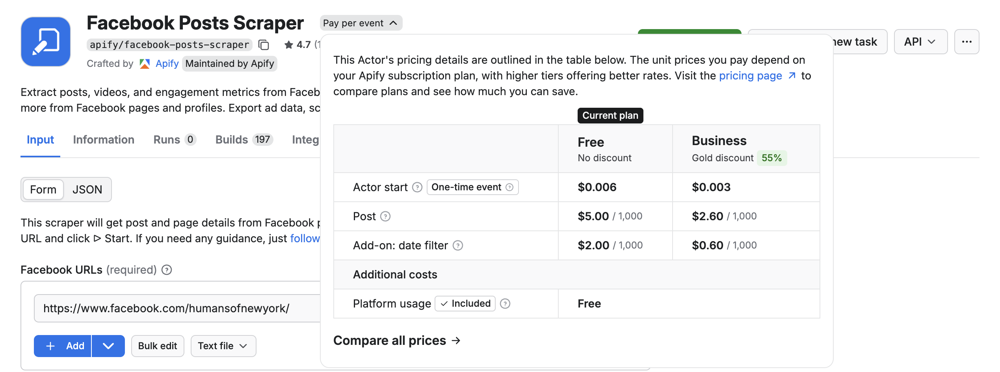
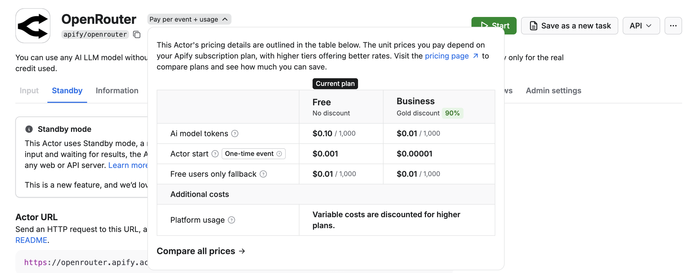
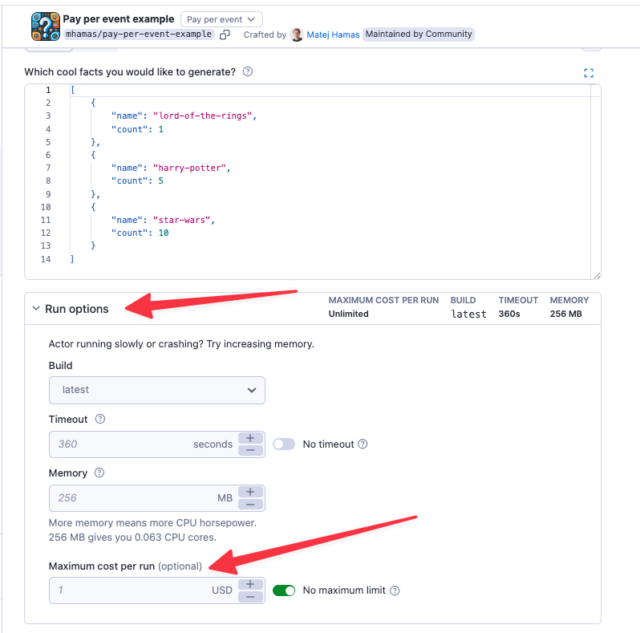
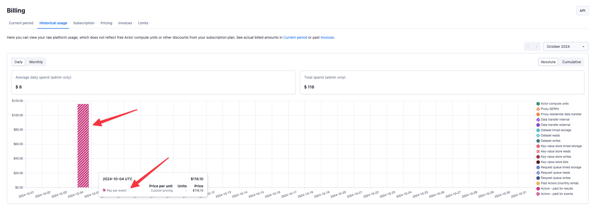
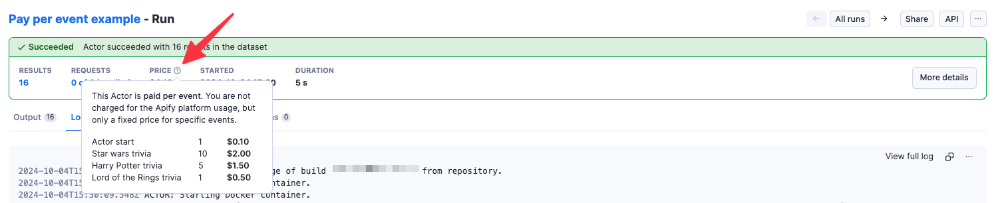
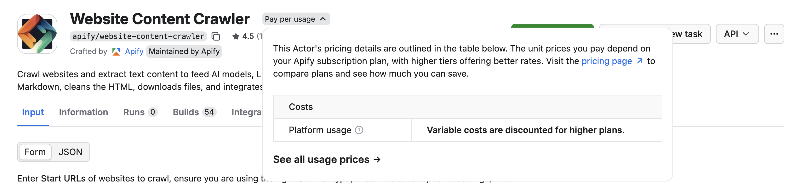
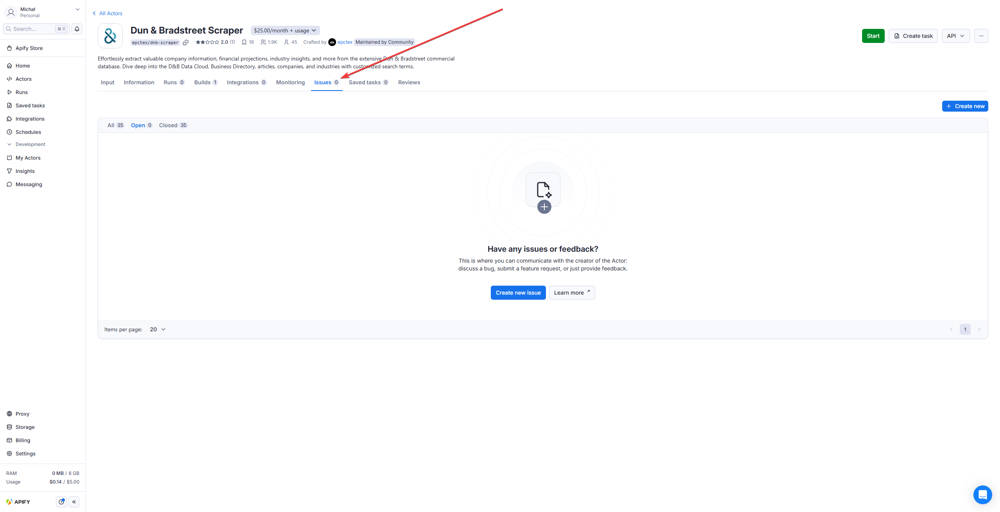
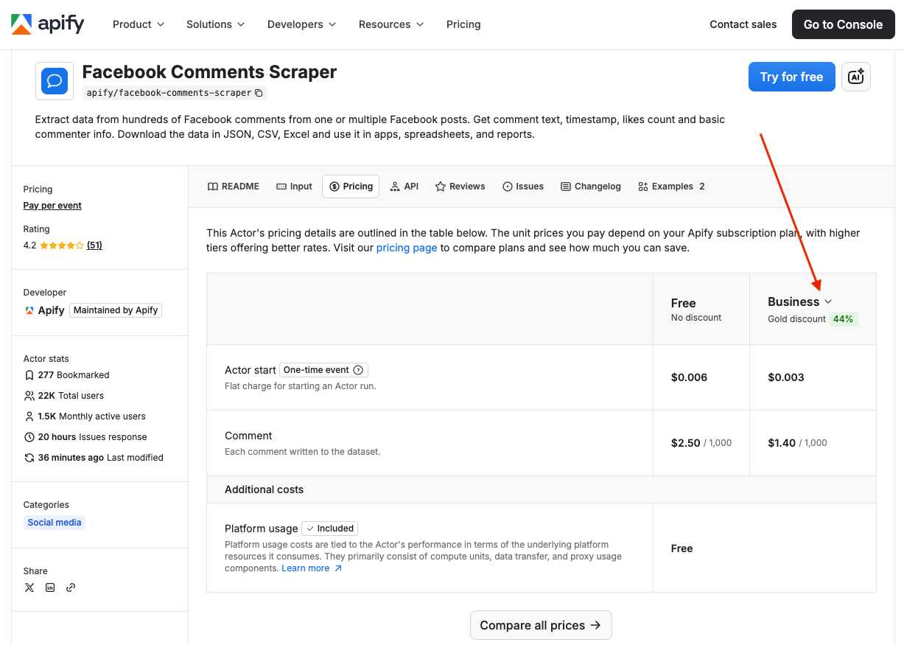
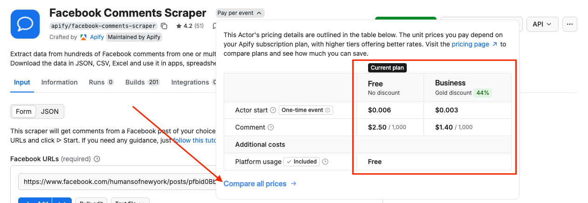
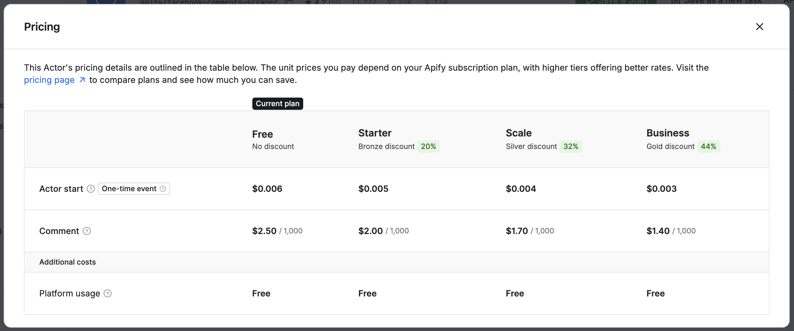

:::info Publishing and monetizing Actors

Anyone is welcome to [publish Actors](/actors/publishing) in the store, and you can even [monetize your Actors](/actors/publishing/monetize). For more information about how to monetize your Actor, best practices, SEO, and promotion tips and tricks, head over to the [Marketing checklist](/academy/actor-marketing-playbook/promote-your-actor/checklist) section of the Apify Developers Academy.

:::

## Pricing models

All Actors in [Apify Store](https://apify.com/store) fall into one of the three pricing models:

- [**Pay per event**](#pay-per-event) - you pay for specific events the Actor creator defines, such as generating a single result or starting the Actor. Most Actors include platform usage in the price, but some may charge it separately - check the Actor's pricing for details.
- [**Pay per usage**](#pay-per-usage) - you only pay for the platform resources (compute units, data transfer, etc.) the Actor consumes. There are no additional charges from the Actor developer.

:::note Post-run storage costs
After a run finishes, any interactions with the dataset - such as reading or writing additional data - incur standard platform usage costs. This applies to all pricing models. Unnamed datasets are automatically removed after your data retention period, so long-term storage is rarely a concern.
:::

### Pay per event

With pay-per-event pricing, you pay for specific events defined by the Actor creator, such as producing a single result, uploading a file, or starting an Actor. These events and their prices are always described on each Actor's page.

[//]: # (TODO: also show the screenshot from Apify Store on Web)

:::caution Some Actors charge platform usage separately

Most pay-per-event Actors include [platform usage](../usage_and_resources.md) in the event price. However, some Actors may require you to pay for platform usage separately. Always check the Actor's pricing section to understand what's included.

:::

When starting a run, you can define a maximum charge limit. The Actor terminates gracefully when it reaches that limit - and even if it does not stop immediately, you are never charged for produced events over the defined limit.

Your charges appear on your invoices and in the [Historical usage tab](https://console.apify.com/billing/historical-usage) in the Billing section of Apify Console. The cost of each run also appears on the run detail page.

If charges seem incorrect, contact the Actor author or the Apify support team. You can also open an issue directly on the Actor's detail page in Apify Console.

### Pay per usage

When you use a pay per usage Actor, you are only charged for the platform usage that the runs of this Actor generate. [Platform usage](../usage_and_resources.md) includes components such as compute units, operations on [storages](/storage), and usage of [residential proxies](/proxy/residential-proxy) or [SERPs](/proxy/google-serp-proxy).

:::info Estimating Actor usage cost

With this model, it's very easy to see how many platform resources each Actor run consumed, but it is quite difficult to estimate their usage beforehand. The best way to find the costs of free Actors upfront is to try out the Actor on a limited scope (for example, on a small number of pages) and evaluate the consumption. You can easily do that using our [free plan](https://apify.com/pricing).

_For more information on platform usage cost see the [usage and resources](../usage_and_resources.md) page._

:::

## Actors under maintenance

An Actor gets the **Under maintenance** label when it fails Apify's [automated tests](/actors/publishing/test), or when its developer sets it. Its page then shows the **This Actor is under maintenance** banner, sometimes with a message from the developer. If you run it, the run can fail or return incomplete results.

If an Actor you use is under maintenance:

- Run it with a small input and check the results.
- On the Actor's **Issues** tab, look for an issue that describes your problem. If there isn't one, create one to ask the developer.
- To find a replacement, select **Show similar Actors** in the banner, or search [Apify Store](https://apify.com/store).

Actors under maintenance rank lower in Apify Store. If an Actor keeps failing the tests, Apify deprecates it.

## Report issues with Actors

Each Actor has an **Issues** tab in Apify Console. There, you can open an issue (ticket) and chat with the Actor's author, platform admins,
and other users of this Actor. Please feel free to use the tab to ask any questions, request new features, or give feedback. Alternatively, you can
always write to [community@apify.com](mailto:community@apify.com).

## Apify Store discounts

Each Apify subscription plan includes a discount tier (_BRONZE_, _SILVER_, _GOLD_) that provides access to increasingly lower prices on selected Actors.

:::note Discount participation

Discount offers are optional and determined by Actor owners. Not all Actors participate in the discount program.

:::

Additional discounts are available for Enterprise customers.

To check an Actor's pricing and available discounts, visit the Pricing section on the Actor's detail page in Apify Store.

In Apify Console, you can find information about pricing and available discounts in the Actor's header section.

