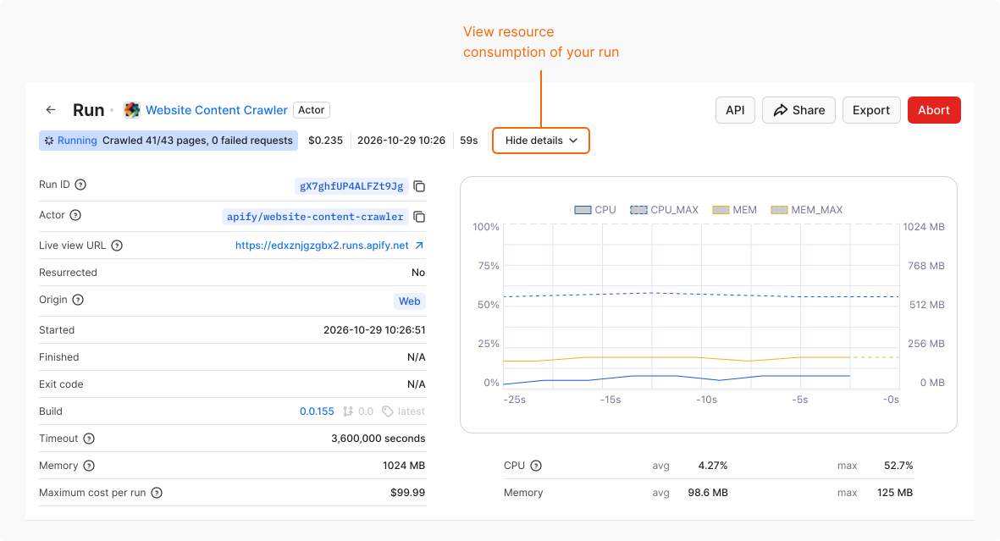

A compute unit (CU) is the unit Apify uses to measure the platform resources that Actor runs and builds use. The price of a CU depends on your [subscription plan](/account/subscriptions).

## Calculate compute units

CUs are calculated by multiplying two factors:

- Memory (GB): The memory allocated to the Actor run or build.
- Duration (hours): How long the run or build lasts. For example, a run that takes 6 minutes lasts 0.1 hours. Duration is measured to the second.

Example: 1 GB (1,024 MB) of memory × 1 hour = 1 CU

## Who pays for compute units

The Actor's [pricing model](/actors/running/actors-in-store) determines who pays for the CUs:

- Pay-per-usage Actors: Users pay for the CUs that the Actor run uses.
- Pay-per-event Actors: In most cases, the Actor developer covers the CUs. Some pay-per-event Actors pass platform usage on to users. You can view the pricing on the Actor's page in Apify Store.

When developing your own Actor, you pay for the CUs used by every run and build that you start.

## Estimate resource consumption

The following factors affect resource consumption, from most to least important:

- Scraping with a browser and using libraries such as [Puppeteer or Playwright](/academy/puppeteer-playwright) uses more resources and is slower than parsing plain HTML with Cheerio or Beautiful Soup. Cheerio and Beautiful Soup can be up to 20 times faster.
- Running one large batch costs less than splitting the same work into many short runs. Each run spends CUs on starting the Actor, and a short run can end before the Actor scales up to use all its allocated memory and CPU.
- Heavy pages, such as Amazon or Facebook, take more time to load, whether you use a browser or plain HTML parser. Large pages can take up to 3 times more resources to load and parse than average pages.

To estimate your monthly usage, run the Actor the way you plan to use it long term and check how many CUs a run uses. For example, you want to scrape data every hour for a month. With 4096 MB of memory, a run takes 15 minutes and uses 1 CU (4 GB × 0.25 hours). Over a month, that's 720 CUs (1 CU × 24 runs × 30 days).

## Check your usage

Apify Console shows your total CU usage for the current billing period and the usage of each run.

### Overall usage

To see a summary of your CU usage:

1. Log in to [Apify Console](https://console.apify.com).
1. In the left-side panel, select **Billing**.
1. Go to the **Current period** tab.
1. Under **Platform usage breakdown by services**, expand the **Actors** section.

### Usage per run

To check the resource consumption of an Actor run:

1. Log in to [Apify Console](https://console.apify.com).
1. In the left-side panel, select **Runs**.
1. From the table, select the run.
1. Next to the run status, select **Show details**.

