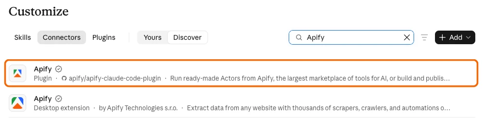
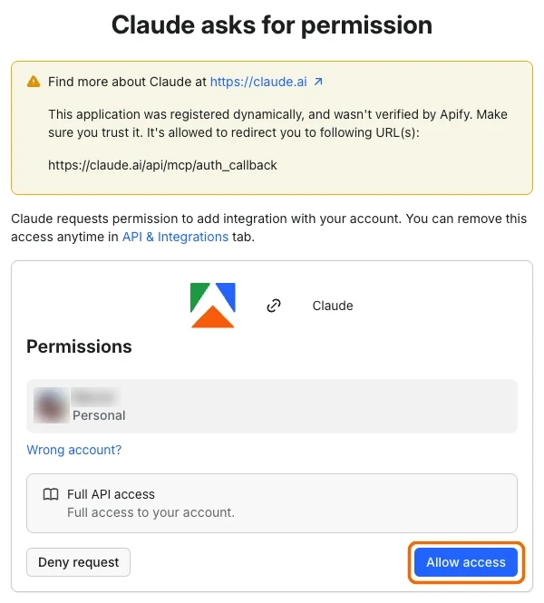

import ThirdPartyDisclaimer from '@site/sources/_partials/_third-party-integration.mdx';
import ApifyPluginSkills from '@site/sources/_partials/_apify-plugin-skills.mdx';
import ApifyPluginSkillPrompts from '@site/sources/_partials/_apify-plugin-skill-prompts.mdx';
import FindGoogleMapsActorPrompt from '@site/sources/_partials/_find-google-maps-actor-prompt.mdx';

[Claude.ai](https://claude.ai) is Anthropic's AI assistant in the browser. It answers questions, works with files, and calls external tools through connectors.

The Apify plugin connects Claude to Apify's library of [Actors](https://apify.com/store) and bundles:

- The [Apify MCP server](/mcp) for searching Apify Store, running Actors, and retrieving datasets through the [Model Context Protocol (MCP)](https://modelcontextprotocol.io/docs/getting-started/intro).
- An `apify` routing agent that picks the right tool or skill from a natural-language request.
- Five built-in skills for common workflows (see [Bundled skills](#bundled-skills) below).

This guide covers setup in claude.ai in your browser. For the desktop app, see the [Claude Desktop integration](/integrations/claude-desktop).

<ThirdPartyDisclaimer />

## Prerequisites

- [An Apify account](https://console.apify.com/sign-up) - sign up for free if you don't have one.
- [A Claude account](https://claude.ai) - you need to be signed in.

## Install the plugin

1. In claude.ai, open **Customize**, then select **Connectors**.

1. Select the **Discover** tab and search for "Apify".

1. Select the **Apify** entry labeled **Plugin**. The **Apify** entry labeled **Desktop extension** is for [Claude Desktop](/integrations/claude-desktop#desktop-extension) only.

    

1. Select **Add**.

The plugin is now installed, but its Apify connector isn't connected yet. Connect it in the next section.

## Authenticate to Apify

The plugin bundles the Apify MCP server as a connector. Connect it and sign in to Apify so Claude can run Actors and access your account data.

1. On the **Apify** plugin page, open the **Connectors** tab. The `apify` connector shows as **Not added**.

1. Select **Connect**. The **Add custom connector** dialog opens with the name and server URL already filled in.

1. Select **Continue**, keep the detected settings, and select **Add**. On the Apify sign-in page, choose the user or organization account Claude should use.

1. On the **Claude asks for permission** page, a warning says that the application was registered dynamically and wasn't verified by Apify. This warning is expected for Claude.

    Check that the Apify account and the redirect URL `https://claude.ai/api/mcp/auth_callback` are correct, then select **Allow access**.

    

1. Back in claude.ai, check that the `apify` connector shows as connected.

The connection stays authenticated for future chats. You can revoke access at any time in [Apify Console > Settings > Integrations](https://console.apify.com/settings/integrations).

## Run your first prompt

New chats have the Apify connector turned on by default. To turn it on or off for a chat, select **+** in the message box, select **Connectors**, and turn **Apify** on or off.

Describe what you want in natural language. You don't need to name Apify tools yourself.

<FindGoogleMapsActorPrompt />

Claude searches Apify Store, fetches the top Actor's details through the Apify MCP server, and summarizes its inputs, pricing, and output - all without running the Actor.

## Bundled skills

<ApifyPluginSkills />

Example prompts that route to specific skills:

<ApifyPluginSkillPrompts />

## Connect without the plugin

To choose which Apify tools Claude can use, add the Apify MCP server as a custom connector instead of installing the plugin. This setup doesn't include the plugin's skills or routing agent. On Team and Enterprise plans, only an Owner or Primary Owner can add a custom connector, and they [add it for the whole organization](https://support.claude.com/en/articles/11175166).

1. Build your setup in the [Apify MCP server configurator](https://mcp.apify.com) and copy the server URL it generates. To use the default tool set, use `https://mcp.apify.com`.
1. In claude.ai, open **Customize** > **Connectors**, select **Add**, then select **Add custom connector**.
1. Fill in the dialog:
    - **Name** - A name for the connector, for example `Apify`
    - **MCP server URL** - The server URL from step 1
1. Select **Continue**, keep the detected settings, and select **Add**.
1. Sign in to Apify and select **Allow access**, as described in [Authenticate to Apify](#authenticate-to-apify).

Claude doesn't let you edit a custom connector. To change the tools later, remove the connector and add it again with a new URL. For the full list of options, see [tool selection](/mcp#tool-selection).

## Troubleshooting

The following sections cover common issues with the plugin and its Apify connector in claude.ai.

### The Apify plugin doesn't appear in Discover

Make sure you're on the **Connectors** tab, then search for "Apify" in **Discover**. If the plugin is already installed, it appears in **Plugins** > **Yours** instead.

### Apify tools don't run

Open **Customize** > **Connectors** and select the **Yours** tab. The `apify` connector should show a check mark in the **Status** column.

If `apify` isn't listed, or shows **Connect**, connect it as described in [Authenticate to Apify](#authenticate-to-apify). To reach the plugin page, open **Customize** > **Plugins**, select the **Yours** tab, and select the **Apify** plugin.

Also check that the chat has the connector turned on: select **+** in the message box, then **Connectors**. If tools still don't run, check the connector's tool permissions and make sure Apify tools are set to **Always allow** or **Ask first**, not blocked.

### Authentication errors or wrong Apify account

Remove the `apify` connector and connect it again to trigger a new sign-in. On the **Claude asks for permission** page, use **Wrong account?** to pick the account Claude should use.

## Limitations

- Long-running Actors may exceed the time a single tool call waits for completion. Reduce the scope or split the work across multiple prompts.
- Each Actor run consumes Apify platform usage from your plan in addition to any Claude usage. See [Apify billing](/account/billing).
- Skills that build or deploy Actors need a local project. They work best in [Claude Code](/integrations/claude-code-cli).

## Related integrations

- [Claude Desktop integration](/integrations/claude-desktop) - Connect the Apify MCP server to the Claude desktop app
- [Claude Code CLI integration](/integrations/claude-code-cli) - Install the Apify plugin in Claude Code
- [MCP server integration](/mcp) - Use the Apify MCP server with other clients
- [ChatGPT integration](/integrations/chatgpt) - Connect the Apify MCP server to ChatGPT

## Resources

- [Anthropic: Get started with custom connectors using remote MCP](https://support.claude.com/en/articles/11175166) - Official docs for connectors, including plan availability and organization setup
- [Apify plugin for Claude](https://github.com/apify/apify-claude-code-plugin) - Source repository for the plugin
- [Apify Store](https://apify.com/store) - Actors you can run from Claude
