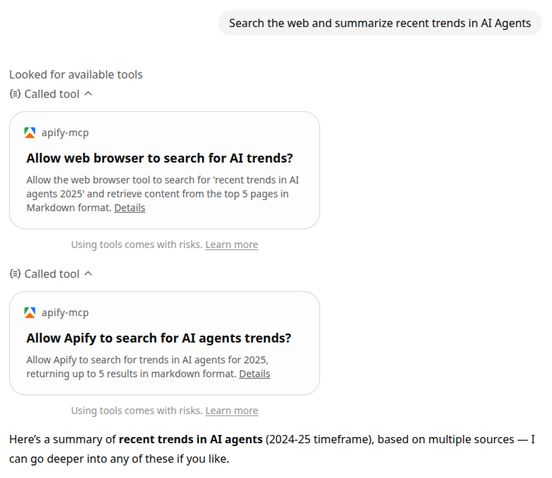

import ThirdPartyDisclaimer from '@site/sources/_partials/_third-party-integration.mdx';

The _ChatGPT_ integration enables you to connect ChatGPT to Apify's extensive library of [Actors](https://apify.com/store) through the [Model Context Protocol (MCP)](https://modelcontextprotocol.io/docs/getting-started/intro).
This allows ChatGPT to access real-time web data and automation capabilities by using Apify tools directly in conversations.
By default, the Apify MCP server exposes a set of tools that let you search and run any Actor you have access to, including all public Actors. For example, you can ask ChatGPT:

```prompt title="Get an Instagram profile"
Find and run an Actor that scrapes Instagram profiles and gets the profile of @natgeo.
```

In this tutorial, you'll learn how to connect _ChatGPT_ to the _Apify MCP server_ by adding it as a custom MCP server plugin.

<ThirdPartyDisclaimer />

## Prerequisites

Before connecting ChatGPT to Apify, you'll need:

- _An Apify account_ - If you don't have an Apify account already, you can [sign up](https://console.apify.com/sign-up)
- _An OpenAI account with access to ChatGPT_ - You need an OpenAI account to use ChatGPT.

You don't need an Apify API token. ChatGPT connects to your Apify account through OAuth.

:::note Business, Enterprise, and Edu workspaces

In ChatGPT Business, Enterprise, and Edu workspaces, admins control who can add custom MCP servers. If you don't see the option to add one, ask your workspace admin for access.

:::

## Add the Apify MCP server

1. In ChatGPT, go to [Plugins](https://chatgpt.com/plugins), select **+**, and then select **Add custom MCP server**.

1. Fill in the following fields:

    - **Name** - a user-facing title, e.g., `apify-mcp`
    - **Description** - a short description of what the plugin does
    - **MCP Server URL** - choose one of the following:
        - `https://mcp.apify.com` - use the default set of Apify tools
        - `https://mcp.apify.com?tools=actors,docs,mtrunkat/url-list-download-html` - use specific tools
        - Refer to [mcp.apify.com](https://mcp.apify.com) for details
    - **Authentication** - OAuth, you don’t need to provide a client ID or secret.

1. Review the risk warning and confirm that you understand it.

1. Select **Create as a plugin** to proceed to the authentication page.
You’ll be redirected to the Apify website to authorize ChatGPT to access your Apify account.

Once authorized, you'll return to ChatGPT and see a list of tools available from the Apify MCP server.

:::tip Update tools after creation
On the plugin's details page, you can turn individual tools on or off. If the tools on the Apify MCP server change, refresh the plugin to load the updated tools.
:::

## Try the Apify plugin in ChatGPT

Once your plugin is ready:

1. Open a **new chat** in ChatGPT.
1. Type `@` in the message box and select your Apify plugin to add it to the conversation.
1. Ask ChatGPT to use Apify tools, for example:

   ```prompt title="Summarize AI agent trends"
   Search the web and summarize recent trends in AI agents.
   ```

You'll need to grant permission for each Apify tool when it's used for the first time.
You should see ChatGPT calling Apify tools to gather information. By default, the Apify MCP server includes web search and fetching tools (`apify/web-search`, `apify/web-fetch`).



## Limitations

- MCP integration in ChatGPT is still in _beta_ and may have some limitations or bugs.
- Tool selection and execution can be _slow_, especially with the latest GPT models.
- When creating plugins that include social media scrapers (Instagram, TikTok), OpenAI may display a _Safety Scan_ warning indicating that some tools might fetch sensitive data.

## Related integrations

- [OpenAI Assistants integration](/integrations/openai-assistants) - Use Apify Actors with OpenAI Assistants API via function calling
- [OpenAI Agents SDK integration](/integrations/openai-agents) - Integrate Apify MCP server with OpenAI Agents SDK

## Resources

- [Connecting custom MCP servers in ChatGPT](https://help.openai.com/en/articles/12584461) - Official OpenAI documentation on using MCP servers with ChatGPT
- [Apify MCP server](https://mcp.apify.com) - Interactive configuration tool for the Apify MCP server
- [Apify MCP documentation](/mcp) - Complete guide to using the Apify MCP server
