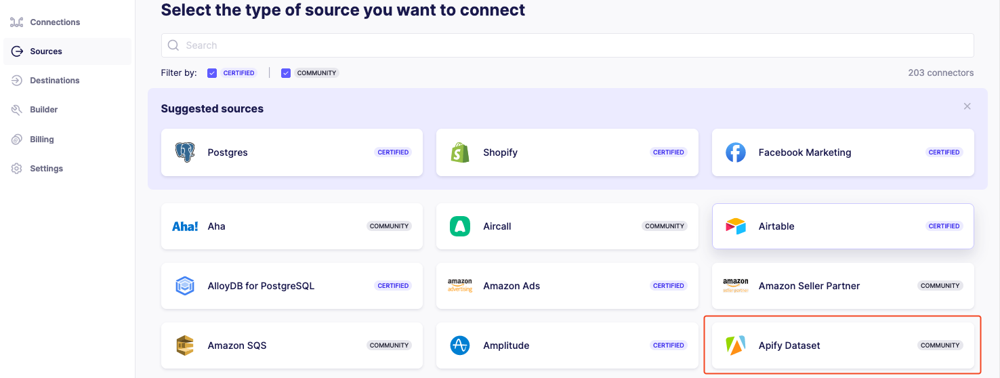
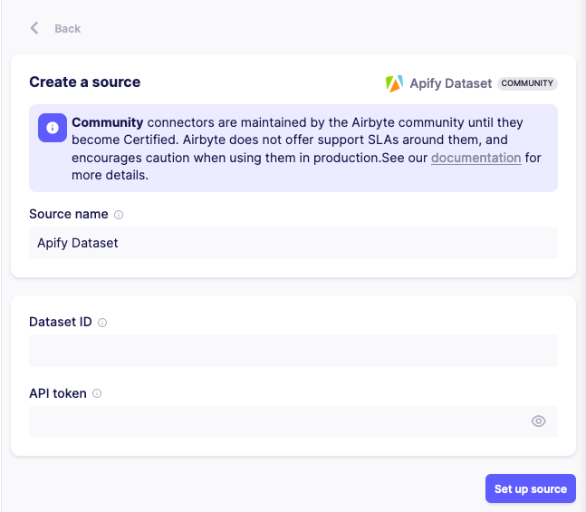
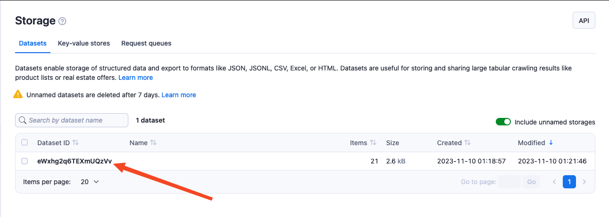
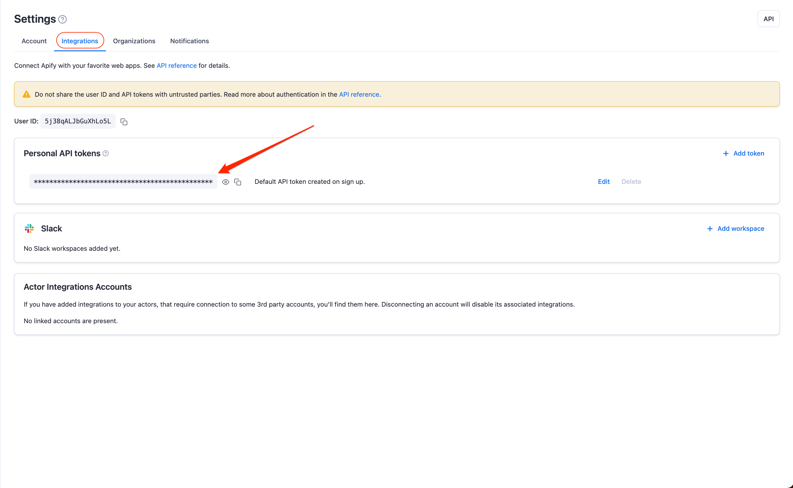

import ThirdPartyDisclaimer from '@site/sources/_partials/_third-party-integration.mdx';

Airbyte is an open-source data integration platform that allows you to move your data between different sources and destinations using pre-built connectors, which are maintained either by Airbyte itself or by its community.
One of these connectors is the Apify Dataset connector, which makes it simple to move data from Apify datasets to any supported destination.

To use Airbyte's Apify connector you need to:

* Have an Apify account.
* Have an Airbyte account.

<ThirdPartyDisclaimer />

## Set up Apify connector in Airbyte

Once you have all the necessary accounts set up, you need to set up the Apify connector.
To do so, you will need to navigate to **Sources** tab in Airbyte and select **Apify Dataset**

You will need to provide a **dataset ID** or dataset name and your Apify API Token. You can find both of these in [Apify Console](https://console.apify.com).

To find your **dataset ID**, you need to navigate to the **Storage** tab in Apify Console. Copy it and paste it in Airbyte.

You can also enter the name of a [named dataset](/storage#named-and-unnamed-storages) with a `~` prefix, for example `~my-dataset`. Airbyte looks up the name in the account that owns your API token. For a dataset owned by another user or organization, enter `username~my-dataset`. The owner must [share the dataset](/storage#share) with you first, or the connection check fails. Each Actor run writes to a new dataset with a new ID by default. If your Actor writes to a named dataset, its name stays the same across runs, so you don't need to update the connector after each run.

A named dataset keeps the items of every run that writes to it, and Airbyte reads the whole dataset on every sync. To sync only the items of the latest run, make your Actor delete the named dataset at the start of each run and create it again.

To find your Apify API token, you need to navigate to the **Settings** tab and select **API & Integrations**. Copy it and paste it in the relevant field in Airbyte.

And that's it! You now have Apify datasets set up as a Source, and you can use Airbyte to transfer your datasets to one of the available destinations.

To learn more about how to setup a Connection, visit [Airbyte's documentation](https://docs.airbyte.com/using-airbyte/getting-started/set-up-a-connection)
