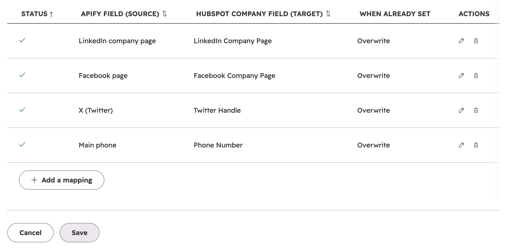
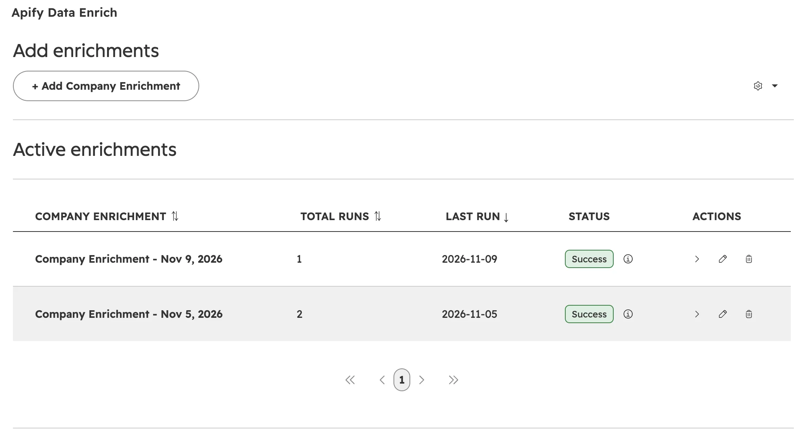
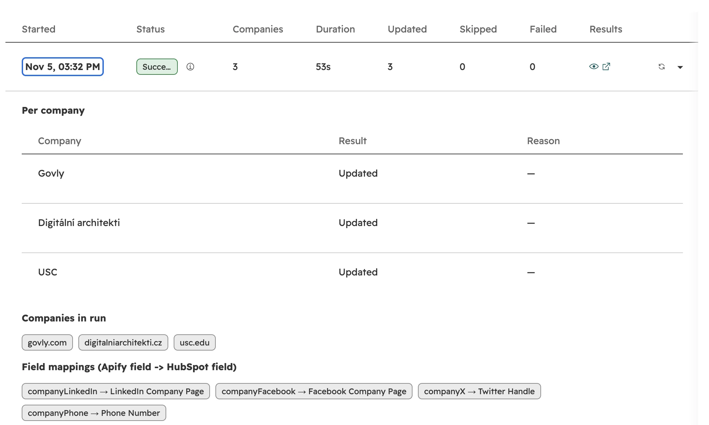
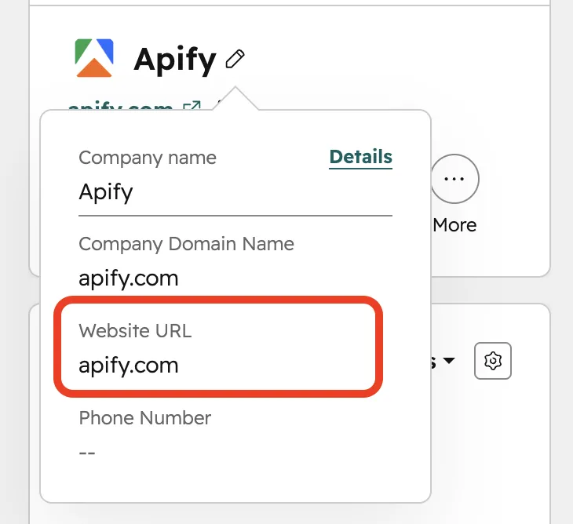
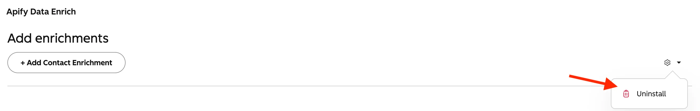

import ThirdPartyDisclaimer from '@site/sources/_partials/_third-party-integration.mdx';

With the Apify integration for [HubSpot](https://www.hubspot.com/), you can enrich your company records with public contact data found on each company's own website. The integration runs as a CRM card inside your HubSpot portal, uses Apify's [Contact Details Scraper](https://apify.com/vdrmota/contact-info-scraper) to crawl the website, and writes the results to the company properties you choose.

The integration fills these fields:

- General email
- Main phone
- LinkedIn company page
- X (Twitter)
- Facebook page
- Instagram
- YouTube
- TikTok

The integration only updates company records. It doesn't create or update contacts, and it doesn't collect data about individual people.

<ThirdPartyDisclaimer />

## Prerequisites

To use the Apify integration for HubSpot, you need:

- A [HubSpot account](https://www.hubspot.com/) with CRM access to companies.
- An [Apify account](https://console.apify.com/).
- Admin permissions in HubSpot to install apps.
- Company records with a website URL in HubSpot (or you can provide a temporary URL).

## Install the integration

Install the Apify app from the HubSpot Marketplace:

1. Find the **Apify** app in the HubSpot Marketplace (or use the install link provided by your Apify contact).
1. Select **Install**. This starts a two-step OAuth authorization:
   - **Step 1:** Authorize the app to read and write company records in your HubSpot portal.
   - **Step 2:** You're redirected to Apify Console to authorize your Apify account.
1. On success, you see an installation confirmation page.

The app is now connected to both your HubSpot portal and your Apify account.

## Add the CRM card

After installation, add the Apify card to your company record pages:

1. In HubSpot, go to **CRM** > **Companies**.
1. Open any company record.
1. Select the **Customize** button on the right side of the record page.
1. Select the **Default view**.
1. Select **Add card**, then go to the **Card Library**.
1. Search for **Apify** and select **Add card**.

The Apify card now appears in the **Apify Data Enrich** tab of your company record pages.

## Create a company enrichment

Select **+ Add Company Enrichment** in the Apify card to open the configuration wizard.

### Step 1: Name the enrichment

Enter an **Enrichment config name**. The default is `Company Enrichment - <date>`.

The wizard also checks that the current company has a website. If its HubSpot record has no `website` or `domain` property, a warning appears with two options:

- **Update the HubSpot record** - edit the company in HubSpot, then select **Check again**.
- **Use a temporary URL** - enter a URL just for this run. The URL isn't saved to the HubSpot record or to the enrichment.

### Step 2: Map fields

Field mappings define which value from the company's website goes into which HubSpot company property. You can map each source field to any company property in your portal, standard or custom.

| Source field | Description |
| ------------ | ----------- |
| **General email** | A role mailbox on the company's own domain, such as `info@` or `sales@`. |
| **Main phone** | The first phone number found on the website. |
| **LinkedIn company page** | The company's LinkedIn page. |
| **X (Twitter)** | The company's X profile. |
| **Facebook page** | The company's Facebook page. |
| **Instagram** | The company's Instagram profile. |
| **YouTube** | The company's YouTube channel. |
| **TikTok** | The company's TikTok profile. |

When you create a new enrichment, these mappings are pre-filled if the target property exists in your portal:

| Source field | HubSpot company property |
| ------------ | ------------------------ |
| **LinkedIn company page** | `linkedin_company_page` |
| **Facebook page** | `facebook_company_page` |
| **X (Twitter)** | `twitterhandle` |
| **Main phone** | `phone` |

Each mapping row has three settings:

- **Apify field (source)** - one of the eight source fields.
- **HubSpot company field (target)** - a HubSpot company property.
- **When already set** - **Overwrite** (replace the existing value) or **Skip if set** (only write when the property is empty).

- Each HubSpot property can only be used once as a target.
- Select **Add a mapping** to add more rows.

Select **Save** to save the configuration.

### Step 3: Choose which companies to enrich

After you save a new enrichment, the **Run Configuration** dialog opens. Choose which companies to enrich:

- **Only this company** - enrich only the current company.
- **Specific companies** - search for and pick several companies.
- **All companies** - enrich every company in your portal.

The same dialog opens whenever you run the enrichment again from its run history, so you can target different companies on each run.

## Manage your enrichments

### Active enrichments list

The **Active enrichments** section of the card shows all company enrichment configurations for the current HubSpot portal.

| Column | Description |
| ------ | ----------- |
| **COMPANY ENRICHMENT** | Config name. |
| **TOTAL RUNS** | Number of runs of this config. |
| **LAST RUN** | Date of the most recent run (newest first). |
| **STATUS** | Status badge of the latest run. |
| **ACTIONS** | Open run history, Edit, Delete. |

The list updates automatically while a run is in progress.

### Run history

Select the arrow next to a config in the active enrichments list to open its run history.

The header shows:

- Config name
- Actor: Contact Details Scraper
- Number of companies targeted and field mappings
- **Run again** and **Edit & run** buttons

Each run in the history table shows:

| Column | Description |
| ------ | ----------- |
| **Started** | When the run began. |
| **Status** | Badge showing the current state. |
| **Companies** | Number of companies in the run. |
| **Duration** | How long the run took (or "In progress" for active runs). |
| **Updated** | Number of companies whose properties were written. |
| **Skipped** | Number of companies with nothing to write. |
| **Failed** | Number of companies HubSpot rejected the update for. |
| **Results** | View the results, or open the dataset in Apify Console. |

Expand a row to see:

- **Per company** - the result for each company, with a **Company**, **Result**, and **Reason** column.
- **Companies in run** - the website domains included.
- **Field mappings** - the mappings applied in that run.

A skipped company shows, for example, `Acme Corp | Skipped | Website could not be scraped (0 pages)`. For all possible results, see [Company results](#company-results).

Select the info icon on a completed run to see the number of companies updated, skipped, and failed, the per-company results, and links to the scraper run and its dataset in Apify Console.

### Abort a run

While a run is in progress, an **Abort** button appears next to the status badge. Selecting it stops the run and marks it as errored with "Aborted by user."

## How enrichment works

Each run goes through two stages:

1. **Scraping** - the Contact Details Scraper visits each company's website. It crawls the homepage and the pages it links to directly, such as contact and about pages, up to 10 pages per website.
1. **Importing** - Apify picks one clean value for each source field and writes the mapped values to the company record in HubSpot.

### How values are picked

The scraper often finds several candidates for a field. The integration keeps only one value per field, using these rules:

- **General email** - only role mailboxes on the company's own domain or its subdomains, such as `info@`, `contact@`, `hello@`, `sales@`, or `support@`. Personal addresses like `jane@` and addresses on other domains are ignored.
- **Main phone** - the first phone number found on the website, written as it appears there.
- **Social profiles** - the first link that points to a profile or page, not to a post, video, or share button. LinkedIn only accepts company or school pages, not personal profiles. Links are normalized, so `twitter.com` links become `x.com`.
- **X handle** - when the target property is `twitterhandle`, the bare handle is written (for example, `apify`) instead of the full URL.

### Overwrite behavior

For each field mapping, you choose what happens when the company property already has a value:

- **Overwrite** - the existing value is always replaced with the scraped value.
- **Skip if set** - the existing value is kept. The scraped value is only written if the property is empty.

If every mapped property is already filled and set to **Skip if set**, the company is skipped.

## Run statuses

| Status | What it means |
| ------ | ------------- |
| **Running** | The Contact Details Scraper is visiting company websites. |
| **Importing** | The scraped values are being written to your HubSpot company records. |
| **Success** | All companies were processed without errors. |
| **Partial Success** | Some companies were updated, others were skipped with a reason or failed. |
| **Error** | The run failed, or no company could be updated. |

Only one run can be active per config. Starting a new run while one is in progress shows an error.

:::note Skipped companies affect the run status

A company skipped with a reason counts toward the run status the same way as a failure. A run where some companies were skipped shows **Partial Success**, and a run where every company was skipped shows **Error**. Check the per-company **Result** and **Reason** to see what happened.

:::

### Company results

| Result | Reason | What it means |
| ------ | ------ | ------------- |
| **Updated** | - | At least one property was written to the company. |
| **Skipped** | No company URL provided | The company has no website or domain. |
| **Skipped** | No matching dataset item found | The scraper returned no data for the company's URL. |
| **Skipped** | Website could not be scraped (0 pages) | The website was unreachable or blocked the scraper. |
| **Skipped** | No mappable data found on the website | The website had none of the fields you mapped. |
| **Skipped** | - | Every mapped property already had a value and was set to **Skip if set**. |
| **Failed** | HubSpot's error message | HubSpot rejected the update, for example because a value didn't pass property validation. |

## Limitations

- **Company records only.** The integration doesn't create or update contacts.
- **One value per field.** If a website lists several phone numbers or LinkedIn pages, only the first valid one is written.
- **Role emails on the company domain only.** Companies whose only email is personal or on another domain, such as a parent brand, get no general email.
- **No phone formatting.** Phone numbers are written as they appear on the website.
- **Shallow crawl.** The scraper visits up to 10 pages per website, one link deep from the homepage. Data on deeper pages can be missed.
- **Company website required.** Each company needs a website or domain in HubSpot, or a temporary URL.
- **One run at a time per config.** You can't start a new run while one is in progress.
- **No automated scheduling.** Runs must be triggered manually.

## FAQ

### Does the integration modify my existing HubSpot data?

Only the company properties you map. Use **Skip if set** on a mapping to keep existing values and only fill empty properties. Contacts are never created or changed.

### Can I enrich multiple companies at once?

Yes. When you run an enrichment, select **Specific companies** to pick several companies, or **All companies** to target every company in your portal.

### How do I see what data was scraped?

Each run in the run history has a **Results** link that opens the dataset in Apify Console. The dataset includes every value extracted for each company, including fields you didn't map.

### Can I cancel a run that is in progress?

Yes. Select the **Abort** button next to the status badge of a running or importing run.

### Does this cost Apify credits?

Yes. The Contact Details Scraper runs on your Apify account and consumes credits for each website it crawls. Check Apify Console for usage and billing details.

## Troubleshooting

### Missing website URL

**Symptom:** When creating a company enrichment, you see a warning that the website URL is required to enrich this company.

**Solution:**

- Edit the company record in HubSpot and add the website URL, then select **Check again**.
- Or enter a temporary URL in the card for this run only.

A company without a website can't be enriched - the scraper needs a URL to visit.

### Company skipped

**Symptom:** A company shows **Skipped** with a reason in the run results.

**Solution:** Check the reason in [Company results](#company-results). The most common causes are:

- The company's website URL in HubSpot is wrong or points to a redirect. Fix the URL and run again.
- The website blocks crawlers. The integration can't enrich these companies.
- The website doesn't list the data you mapped. Try mapping more source fields.

### Run errors

**Symptom:** A run shows **Error** status.

| Error stage | Cause |
| ----------- | ----- |
| **Scraping** | The scraper run failed. |
| **Importing** | The HubSpot connection is missing permissions or has expired, or every company was skipped or failed. |

Select the info icon on the run to see the error message, and select **View scraper run** to see the details in Apify Console.

## Uninstall the integration

To remove the Apify integration from HubSpot, select the settings icon in the top-right of the Apify card, then select **Uninstall**.

Company data already written to HubSpot remains - only the app connection is removed.

## Next steps

- After setting up your first enrichment, browse the [Apify Store](https://apify.com/store) for more scraping Actors.
- If you're building custom workflows, see how to [integrate Actors via API](/integrations/actors/integrating-actors-via-api).
- For questions or help, contact the Apify team at [integrations@apify.com](mailto:integrations@apify.com) or in the [developer community on Discord](https://discord.com/invite/jyEM2PRvMU).
