import ThirdPartyDisclaimer from '@site/sources/\_partials/\_third-party-integration.mdx';

With the Apify integration for [Snowflake](https://www.snowflake.com/), you can run Apify Actors and tasks and import their results into your Snowflake data warehouse without leaving the Snowflake UI. The integration is distributed as a [Snowflake Native App](https://docs.snowflake.com/en/developer-guide/native-apps/native-apps-about) with a built-in Streamlit interface for running Actors, importing datasets, and scheduling recurring imports.

<ThirdPartyDisclaimer />

To get started with the integration:

1. [Install Apify Integration](#install-apify-integration) from the Snowflake Marketplace and connect your Apify account.
1. [Run an Actor](#run-an-actor) or [run a task](#run-a-task) directly from Snowflake.
1. [Import the results](#import-a-dataset) into a Snowflake table.
1. [Schedule recurring imports](#schedule-recurring-imports) to keep your tables up to date.

## Prerequisites

To use the Apify integration for Snowflake, you need:

- An [Apify account](https://console.apify.com/)
- A [Snowflake account](https://www.snowflake.com/) with a role that can install Native Apps and create External Access Integrations

## Install Apify Integration

Install the _Apify Integration_ from the Snowflake Marketplace and follow the guided setup:

1. [Install from Snowflake Marketplace](#step-1-install-from-snowflake-marketplace) - find and install the app.
1. [Set up External Access Integration](#step-2-set-up-external-access-integration) - allow the app to reach the Apify API.
1. [Grant required privileges](#step-3-grant-required-privileges) - enable session access and table creation.
1. [Verify the connection](#step-4-verify-the-connection) - confirm your Apify account is linked.

### Step 1: Install from Snowflake Marketplace

In Snowsight, open the **Data Products** menu and navigate to the **Marketplace**. Search for **Apify** and open the listing, then select **Get** to begin installation.

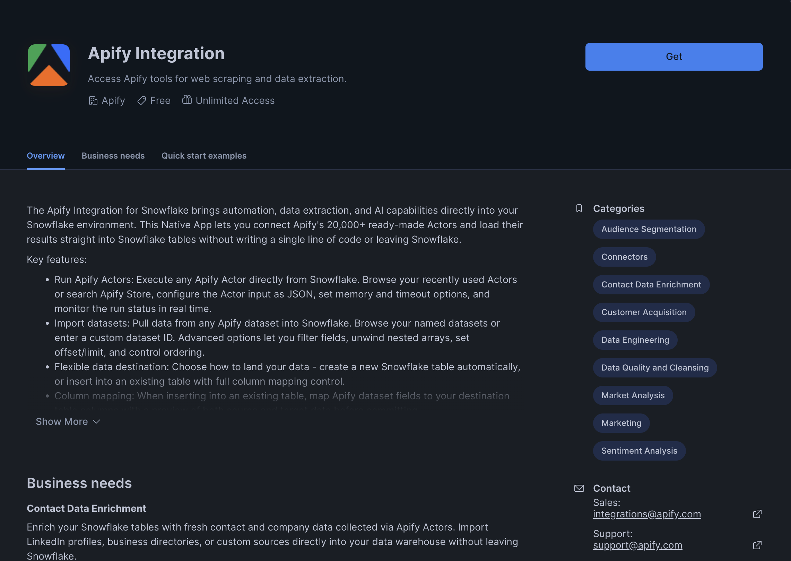

### Step 2: Set up External Access Integration

During installation, the app prompts you to create a `Network Rule` and an `External Access Integration` so the app can reach the Apify API. The suggested network rule allows `api.apify.com` for the Apify API, and `images.apifyusercontent.com`, `apify-image-uploads-prod.s3.amazonaws.com`, and `apify-image-uploads-prod.s3.us-east-1.amazonaws.com` for Actor pictures.

Follow the instructions shown in the setup screen to create the External Access Integration. On the same screen, select **Configure** next to **Apify API Token** and bind a Snowflake secret of type Generic String containing your [Apify API token](https://console.apify.com/settings/integrations). To choose between a personal and an organization token, see [Choose an API token](#choose-an-api-token).

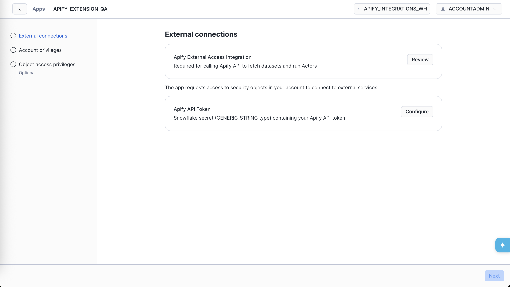

### Step 3: Grant required privileges

After the External Access Integration is in place, grant the app the account-level privileges it asks for:

- `READ SESSION` (required) - lets the app identify the current Snowflake user, so it can keep per-user settings such as dismissed help cards.
- `CREATE DATABASE` (optional) - lets the app create the `APIFY_EXPORTS` database for imports that [create a new table](#create-new-table). Without it, you can only import into existing tables.

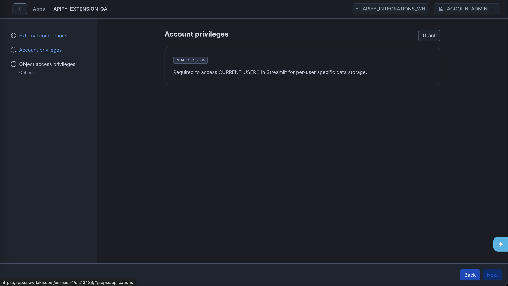

### Step 4: Verify the connection

Once installation is complete, open the app. The **Home** page shows whether the app is connected to Apify, the Apify account it uses, and your most recent imported dataset, Actor run, and scheduled run.

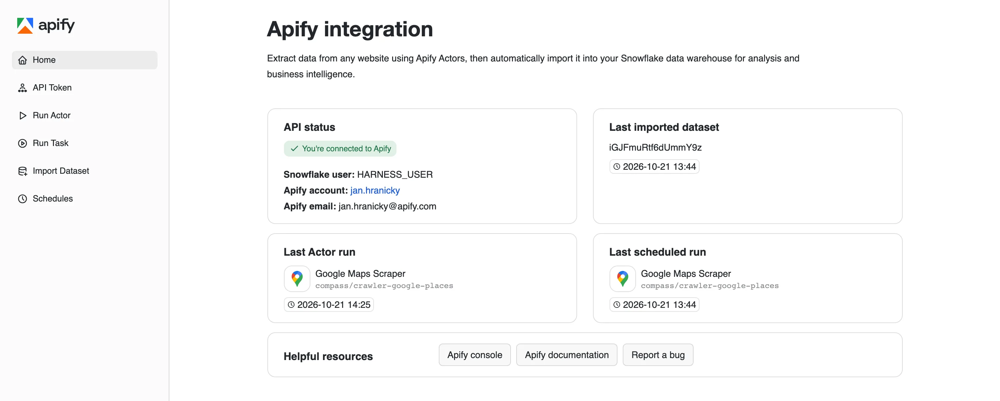

The **API Token** page shows the connection status on its own. If the app isn't connected, users with the `ACCOUNTADMIN` role also see instructions for fixing the connection.

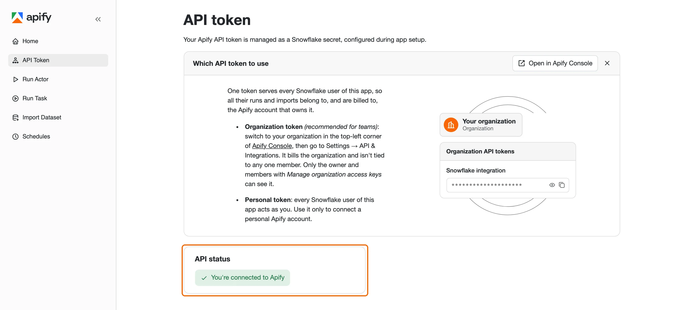

#### Choose an API token

The app uses one Apify API token for every Snowflake user in the account. Every run, import, and schedule the app creates belongs to the Apify account that owns that token and is billed to it.

- _Organization token_ (recommended for teams) - billed to your [Apify organization](/account/collaboration/organization) and not tied to any one member. In [Apify Console](https://console.apify.com/settings/integrations), switch to your organization in the top-left corner, then go to **Settings** > **API & Integrations**. Only the organization owner and members with the _Manage organization access keys_ permission can see organization tokens.
- _Personal token_ - every Snowflake user of the app acts as you. Use it only for single-user setups.

To switch tokens later, go to **Admin** > **Security** > **Secrets** in Snowsight, find the secret bound to the app, and update its value.

## Run an Actor

The **Run Actor** page lets you start an Apify Actor run from within Snowflake and then import its results:

1. [Select an Actor](#step-1-select-an-actor) - choose from your recently used Actors or all Actors in Apify Store.
1. [Configure and run](#step-2-configure-and-run) - provide input and start the run.
1. [Monitor the run](#step-3-monitor-the-run) - track progress with live status updates.
1. [Import results](#step-4-import-results) - load the run's dataset into Snowflake.

### Step 1: Select an Actor

Use **Actor source** to pick where the Actor comes from:

- **Recently used** - Actors you've run in your Apify account.
- **All Actors** - every Actor in [Apify Store](https://apify.com/store).

Search for the Actor under **Choose an Actor**, or type an Actor ID or name, such as `compass/crawler-google-places`. Then select **Configure Actor**.

### Step 2: Configure and run

The **Actor input** field is prefilled with the Actor's example input. Edit it as a JSON object, or select **Open in Apify Console** to fill in the Actor's input form there, switch it to **JSON**, and paste the result back.

Expand **Advanced run options** to set:

- **Timeout** - maximum run duration in seconds (default 3600). Set to `0` for no timeout.
- **Memory** - RAM allocated to the run (default 4096 MB). More memory means more CPU.

Select **Run Actor** to start the run.

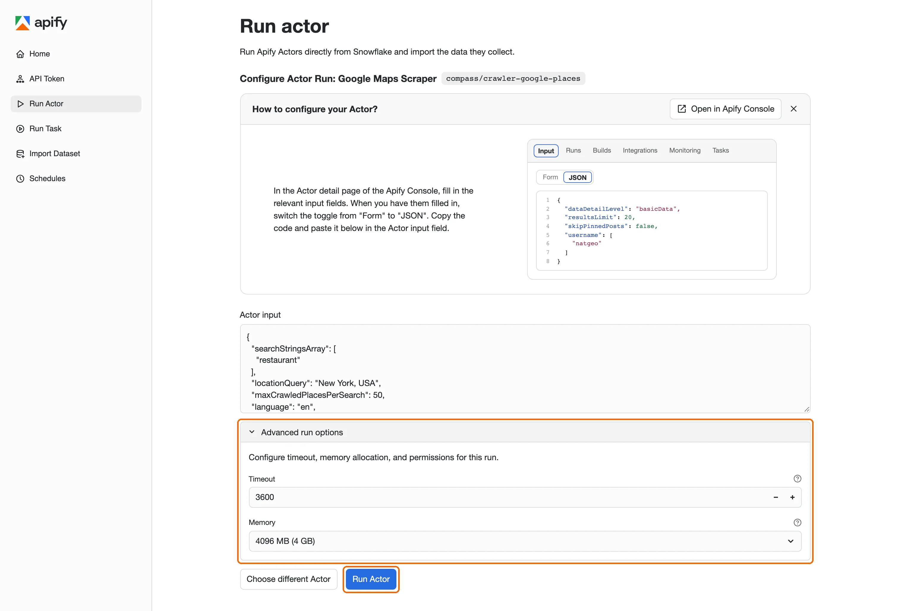

### Step 3: Monitor the run

The page shows the run's live status. The **Manage run** card links to the run and its dataset in Apify Console, and **Run details** lists every status change. Select **Abort run** to stop the run, or **Change input** to edit the input for a new run.

### Step 4: Import results

When the run finishes, select **Import dataset** to open the **Import Dataset** page with the run's default dataset selected. Then follow the [import steps](#import-a-dataset). If the run fails, select **Run again** to retry it with the same input.

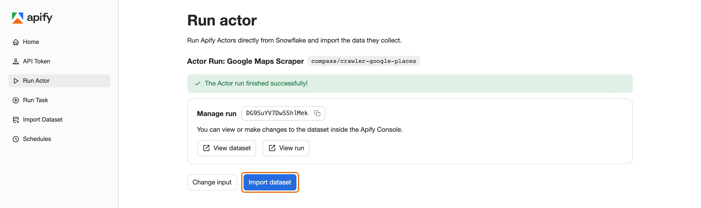

## Run a task

The **Run Task** page runs one of your saved [Apify tasks](/actors/running/tasks), so you don't have to enter the Actor input again:

1. Choose a task under **Choose a Task**, or type a task ID or `username~task-name`, then select **Configure Task**.
1. Optionally, enter JSON under **Task input**. Its fields are merged on top of the task's saved input, and fields you leave out keep their saved value. Leave it as `{}` to run the task as saved.
1. Select **Run Task**.

The run then works the same way as an Actor run: [monitor it](#step-3-monitor-the-run), then select **Import dataset** to [import its results](#import-a-dataset).

## Import a dataset

The **Import Dataset** page fetches items from an Apify dataset and loads them into a Snowflake table.

### Step 1: Select a dataset

Choose one of your named datasets from the dropdown, or enter a dataset ID. You can find dataset IDs in [Apify Console](https://console.apify.com/storage/datasets) under **Storage** > **Datasets**.

The app reads the dataset's first item when you select it, so **Advanced options** can offer the dataset's own field names. Expand it to refine what data is fetched:

| Option               | Description                                                                                                                      |
| -------------------- | -------------------------------------------------------------------------------------------------------------------------------- |
| **Select fields**    | Fields to include, exported in the order you pick them.                                                                          |
| **Omit fields**      | Fields to exclude.                                                                                                               |
| **Unwind**           | Array or object fields to unwind. Each element of an array becomes a separate row, merged with its parent item.                  |
| **Flatten**          | Fields whose nested objects are flattened into the parent using dot notation, so `{"foo": {"bar": 1}}` becomes `{"foo.bar": 1}`. |
| **Offset**           | Number of items to skip from the beginning of the dataset.                                                                       |
| **Limit**            | Maximum number of items to fetch.                                                                                                |
| **Clean**            | Excludes empty items and hidden fields, which start with `#`.                                                                    |
| **Descending order** | Returns items in reverse order.                                                                                                  |
| **Signature**        | Required only for a dataset shared with you as a signed link.                                                                    |

Select **Fetch data** to retrieve a preview of the dataset.

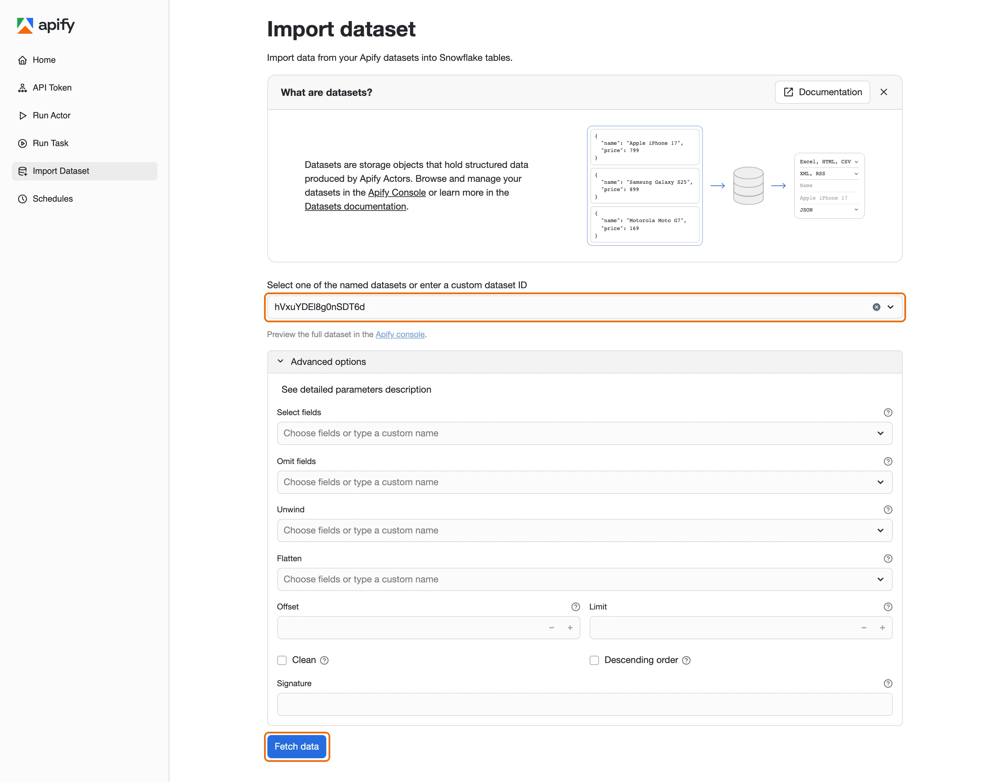

### Step 2: Choose an import method

The preview shows the first rows of the dataset. Select how you want to load it into Snowflake: [create a new table](#create-new-table) or [insert into an existing table](#insert-into-existing-table).

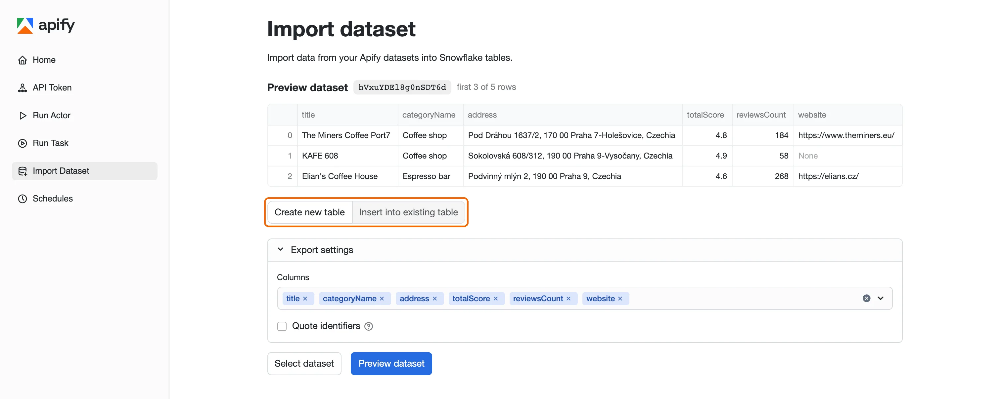

#### Create new table

The app creates a new table in the `APIFY_EXPORTS.DATASETS_EXPORTS` schema, which requires the optional `CREATE DATABASE` privilege. Under **Export settings**, pick the **Columns** to include.

By default, column names are converted to standard Snowflake identifiers (uppercase, with only letters, digits, and underscores), so you don't need to quote them in queries. Select **Quote identifiers** to keep the names exactly as they appear in the dataset instead. Quoted names must be quoted in every query that references them, for example `"my-column"`.

Select **Preview dataset** to check the rows as they'll be written, then select **Export dataset**.

Tables created by the app are owned by the app. To query them outside the app, see [Manage table visibility](#manage-table-visibility).

#### Insert into existing table

Use **Select destination table** to pick the table. Snowflake asks you to grant the app access to it. Then map each destination column to a dataset field, or leave it as **Ignore**. Select **Preview dataset** to check the result, then select **Export dataset**.

### Step 3: Review the result

When the export finishes, the page shows the table the data was written to. Select **Import another dataset** to start over, or **Schedule export** to [repeat this import on a schedule](#schedule-an-existing-import). If the export fails, select **Export again** to retry it without reconfiguring the import.

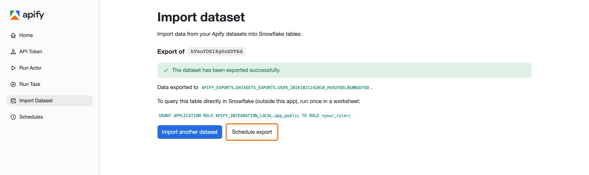

## Manage table visibility

Tables created by the app live in `APIFY_EXPORTS.DATASETS_EXPORTS` and are owned by the app, so Snowflake requires access to be granted through the app's `app_public` application role. Grant that role to your account role once, in a Snowsight worksheet:

```sql
GRANT APPLICATION ROLE <app_name>.app_public TO ROLE <your_role>;
```

Replace `<app_name>` with the name of the installed app and `<your_role>` with the role you query data with. After this one-time grant, the role can read all current and future tables the app exports. Scheduled imports that create a new table also need it, see [Before you start](#before-you-start).

Alternatively, open the app in Snowsight, go to the **Access management** tab, and select **Add** to assign the `app_public` role to any account role.

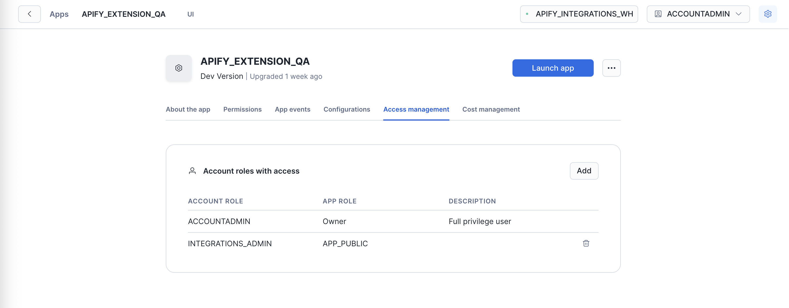

## Schedule recurring imports

The **Schedules** page creates recurring Actor or task runs whose results are imported into Snowflake automatically. Each schedule lives in your Apify account: on every run, Apify starts the Actor and, when the run succeeds, imports its dataset into your Snowflake table. Schedules keep running when the app is closed, until you pause or delete them.

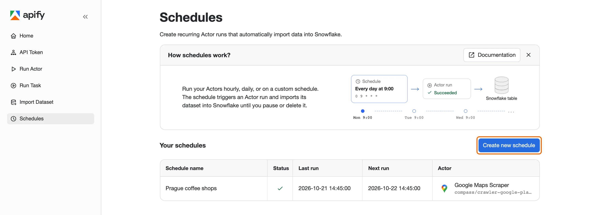

### Before you start

Scheduled imports run outside Snowflake and connect back to your account to write the data, so each schedule needs:

- A Snowflake [programmatic access token (PAT)](https://docs.snowflake.com/en/user-guide/programmatic-access-tokens) for a user whose role can write to the destination table. Snowflake only accepts a PAT from a user who is subject to a [network policy](https://docs.snowflake.com/en/user-guide/network-policies). Apify Actor runs don't connect from a fixed range of IP addresses, so the policy must allow connections from them.
- For imports that create a new table, the `app_public` role granted to that user's role, as described in [Manage table visibility](#manage-table-visibility). The app checks for this grant and won't create the schedule without it.

### Create a schedule

On the **Schedules** page, select **Create new schedule** and follow the four steps:

1. **Schedule setup** - enter a **Schedule name** and pick a **Frequency**: every few minutes or hours, daily, weekly, monthly, yearly, or a custom **Cron** expression. The app previews the next five runs. Schedules run in your browser's time zone.

    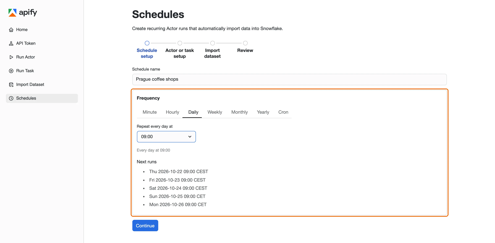

1. **Actor or task setup** - pick **Choose an Actor** and enter its input, or pick **Choose a task** and optionally enter input overrides. Select **Continue** to start a preview run. The schedule repeats this run, so its dataset shows you the data each scheduled run produces.
1. **Import dataset** - when the preview run finishes, select **Continue** and configure the import as on the [Import Dataset](#import-a-dataset) page. The dataset is locked to the preview run's, since every scheduled run imports the dataset it produces itself. For the same reason, **Unwind** and **Flatten** aren't available, and **Offset** and **Limit** apply to the preview only.
1. **Review** - check the schedule and its destination table, then fill in the Snowflake connection details: **Snowflake account identifier**, **Snowflake username**, the PAT, and optionally a **Snowflake warehouse**. For the username, enter your _login name_, which you find in Snowsight under your name > **Connect a tool to Snowflake** > **Login name**. Select **Save and start**.

    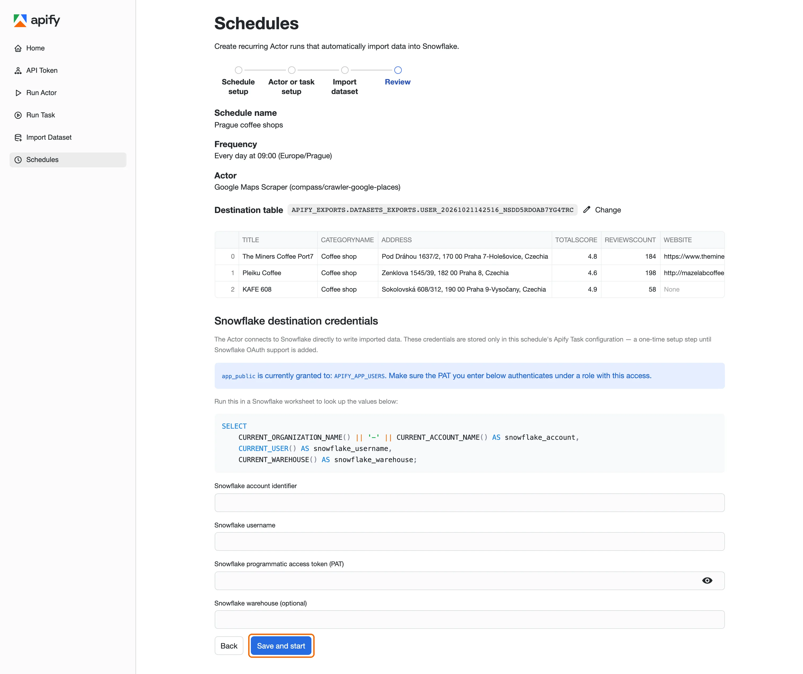

The Snowflake credentials are stored only in the schedule's configuration in your Apify account.

### Schedule an existing import

After a successful import on the **Import Dataset** page, select **Schedule export** to repeat the Actor run that produced the dataset, with the same input, run options, and destination table. You only name the schedule and set its frequency before the review. This works for a run's default dataset, and not for imports fetched with **Unwind** or **Flatten**.

### Manage schedules

Select a schedule in the list to open its detail page, where you can:

- **Run now** - start a run immediately, outside the schedule.
- **Pause** - stop the schedule's runs. A paused schedule shows **Resume** instead, which restarts them.
- **Delete** - remove the schedule and everything it created in your Apify account.
- **Edit timing** - change the frequency.
- **Run history** - check each run's status, start time, and the number of rows it imported.

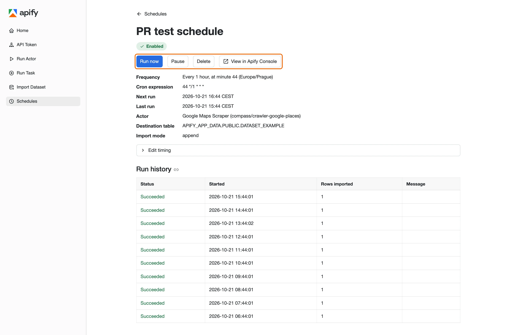

## Next steps

With Apify data in Snowflake, you can query it with standard SQL, join it with your existing tables, and connect it to business intelligence (BI) tools like Tableau, Looker, or Snowflake's own data-sharing features.

For questions or help, contact the Apify team at [integrations@apify.com](mailto:integrations@apify.com), through the live chat, or in the [developer community on Discord](https://discord.com/invite/jyEM2PRvMU).
