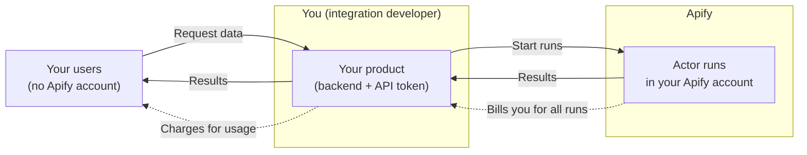

_Whitelabel access_ lets you build Apify into your own product, so that the people who use your product can run Apify Actors without knowing about Apify or having an Apify account. For example, an AI agent platform can let its users pull Instagram data into their agents, while the platform runs Apify Actors in the background.

## How whitelabel access works

A whitelabel integration involves three parties:

- _You_ build a product, such as an AI agent platform or an automation tool, and integrate it with Apify. Your backend starts every Actor run under your Apify account, using your API token.
- _Your users_ are the people or companies who use your product. They choose what to run in your product's interface. They don't have Apify accounts and never interact with Apify directly.
- _Apify_ runs the Actors and bills your account for all runs.

When one of your users needs data, your product starts an Actor run under your Apify account and passes the results back to the user. Apify charges you for the usage of all your users combined, and you decide how to charge your users for it, for example as part of a subscription or per request.

This differs from [direct user billing](/integrations/integrate#direct-user-billing), where each of your users connects their own Apify account, runs Actors under that account, and pays Apify directly.

Because all runs happen under your account, you're responsible for keeping your users' data separate, knowing which user started each run, and covering the cost. The rest of this page covers what to set up, in order. To discuss a partnership, pricing for your volume, or higher limits, contact [integrations@apify.com](mailto:integrations@apify.com).

## Secure your account

Your users decide which Actors run, and every run happens under your Apify account. Without extra setup, a [full-permission Actor](/actors/running/permissions#full-permission-actors) can access your whole account, including data from runs of your other users.

Before you open Actor runs to your users, follow [Run Actors with restricted access](/actors/running/restricted-access). It shows how to keep your users' run data private and how to start runs with a scoped token that limits what each Actor can reach.

## Identify your platform

Send the `x-apify-integration-platform` header with your platform name on every API request. If you have more than one Apify app, also send `x-apify-integration-app-id`. Apify uses these headers to monitor and support your integration. See [Monitor and track](/integrations/integrate#monitor-and-track).

## Attribute runs to your users

Apify doesn't know which of your users started a run, so keep that mapping in your own system:

1. When a user starts an Actor, store the run `id` from the API response together with your user's ID.
1. To find out when the run finishes without polling, add an [ad-hoc webhook](/integrations/webhooks/ad-hoc-webhooks) when you start the run, pointing to your backend.
1. When the run finishes, look up the user by the run ID, then read the results and the cost of the run.

## Pass costs on to your users

Apify bills all runs to your account. To charge your users for what they use, read the cost of each finished run from the [run object](/api/v2/actor-run-get):

- `usageTotalUsd` is the total cost of the run in USD. For pay-per-event Actors, it includes the charged events and any platform usage the Actor charges on top. For pay-per-usage Actors, it's the platform usage. The value can change shortly after the run finishes, while Apify accounts for the last charged events.
- `eventUsage` breaks down the cost of a pay-per-event run by event type, which you can show to your users.

To cap what a single run can cost, set `maxTotalChargeUsd` when you start it, for example based on the user's remaining budget in your product. Before you offer an Actor to your users, check its pricing. See [Actor pricing models](/actors/running/actors-in-store#pricing-models).

To protect your account from unexpected usage across all users, set usage limits in the **Limits** tab of **Billing** in Apify Console. See [Billing limits](/account/billing#limits).

## Plan for limits

All your users share the limits of your Apify account:

- Concurrent runs: The maximum number of Actor runs at the same time depends on your plan. See [Apify platform limits](/account/limits#apify-platform-limits).
- API rate limits: Apify limits requests per user and per resource. See [Rate limiting](/api/v2#rate-limiting).

To raise the limits on a paid plan, [contact support](https://apify.com/contact).
